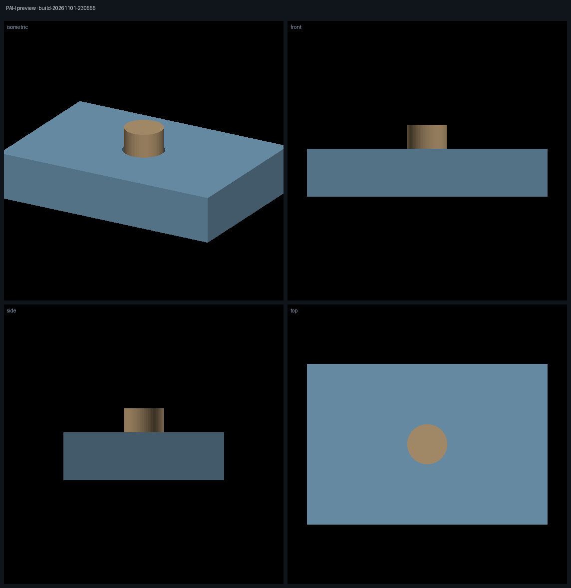
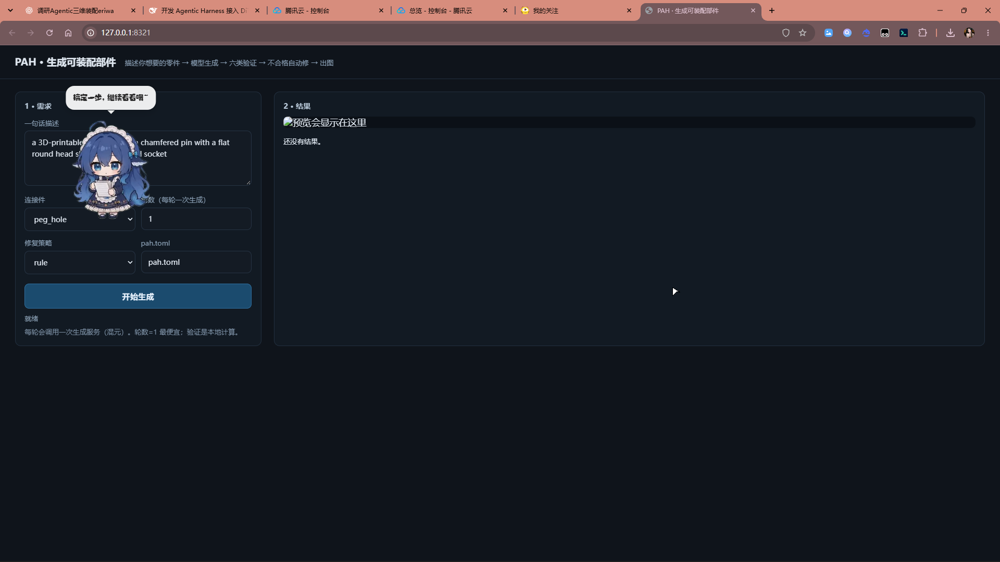

# PAH — Physics-Aware Harness

给 3D 可装配部件做的 **agentic harness**：一句话需求 → 设计意图 → 生成几何 → 六类验证 → 自动返修 → 出图。

```powershell
pah build "a pin with a flat round head that seats into a blind socket" --kind peg_hole
pah serve          # 或者打开网页，在输入框里写 prompt
```



## 三分钟上手

```powershell
cd D:\yanyi\pa-harness
pip install -e .                       # 一次

# 1) 配 key（只写一次，pah 启动自动读）
copy .env.example .env                 # 填 DEEPSEEK_API_KEY / TENCENTCLOUD_SECRET_ID+KEY

# 2) 检查外部服务（不花钱）
pah providers doctor
pah providers doctor --role llm --call # 花一次极小调用，证明模型能应答

# 3) 生成 + 看
pah build "a pin with a flat round head that seats into a blind socket" --kind peg_hole --rounds 1
pah preview runs/build-<时间戳>        # 只重新出图
```

产物都在 `runs/<你的目录>/`：

| 文件 | 是什么 |
|---|---|
| `preview.png` | 四视图渲染（等距/前/侧/顶），直接打开看 |
| `preview.html` | 单文件 3D 浏览器，双击即可旋转缩放（STL 已内嵌，离线可用） |
| `geometry/body.stl`、`geometry/insert.stl` | **你的零件**，可直接进切片软件 |
| `report.json` | 判定、每轮动作、成本、验证器说明（未评估项单列） |
| `trace.jsonl` | 逐事件轨迹（可复现、可恢复） |
| `spec.json` | 这次用的设计意图（改它再跑一次即可） |

## 两种用法

**命令行**（适合脚本、批处理、复现实验）

```powershell
pah build "<prompt>" --kind peg_hole|snap_fit|dovetail --rounds 1 --policy rule|random|llm
pah run   --spec runs/x/spec.json --policy llm --rounds 3     # 已有 spec 上跑闭环
pah eval  --suite fixtures/design/stress --policies rule,random --rounds 3
```

**网页**（适合试 prompt、给人演示）

```powershell
pah serve            # http://127.0.0.1:8321
```



左边写一句话、选连接件、选轮数，点「开始生成」；右边实时显示日志、四视图预览、STL 与报告链接。
同一时间只跑一个任务；刷新页面还能看到上一次的结果。

## 命令表

| 命令 | 用途 |
|---|---|
| `pah build "<prompt>"` | 需求 → 设计 → 生成 → 验证 → 返修 → 预览（一条命令） |
| `pah serve` | 本地网页，输入 prompt 看结果 |
| `pah preview <run>` | 重新渲染某次运行的 PNG/HTML |
| `pah run --spec ...` | 在已有 spec 上跑一个 episode（含预算/恢复/注入故障） |
| `pah design new / sanity` | 写初始 spec；验证器自检 |
| `pah eval` | 等预算策略对比（rule/random/llm），口径分列 |
| `pah providers doctor` | 外部服务自检（LLM 端点、生成器适配器） |
| `pah plugins list` | 已加载的能力（连接件/验证器/算子/策略/供应商） |

## 它是什么 / 不是什么

| 是 | 不是 |
|---|---|
| 决策—工具—验证的闭环（Ticket / Mandate / Round / Budget / Trace） | 新的 3D 生成模型 |
| 预训练 Agent 在可信证据与硬约束下改设计 | CAD 前端 |
| 可换生成后端（混元生 3D、本地 CAD、未来的 DiT） | RL 训练框架 |
| 等预算可比、可复现的评测底座 | 某个数据集的连接件算法 |

不变量：**证据先于修复**（只有通过自检的验证器能写观测）、**预算是第一类对象**（验证开销也记账）、**内核零 I/O 且状态由事实派生**、**未知不等于通过**。

## 生成后端

默认是参数化几何（无需外部服务）。接混元生 3D 见 [docs/first-test.md](docs/first-test.md) §2.5：`.env` 填 SecretId/SecretKey，`pah.toml` 把 `[gen]` 指到 `examples/hunyuan3d_materializer.py`。

适配器要做三件事，代码里已实现并写了理由：**闭合**（生成模型给的是开放壳 → 体素重建）、**对齐**（长轴朝 Z）、**归一化**（等比缩放到设计销径 + 裁到设计包络）。接口尺寸永远由 spec 决定，不由模型决定。

## 目录

```text
src/pah/
├── core/       # 实体、不变量、唯一写者（零 I/O）
├── app/        # store / effects / trace / providers / runtime / env
├── design/     # DesignSpec + 三种连接件几何 + 物化 + 冻结契约 api.py
├── policy/     # 循环驱动器、7 个算子、rule / random / llm / case_memory
├── tools/      # 验证器（间隙/干涉/路径/可打印/物理）、IVR、几何适配
├── eval/       # 等预算 runner + 分列报表
├── plugins.py  # 插件加载器（builtin / pah.toml / entry point）
└── cli/        # build / serve / preview / run / design / eval / providers / plugins
```

## 已实测（2026-11-01）

| 项 | 结果 |
|---|---|
| 契约案例 peg 10.2 / hole 10.0 | rule **1 轮修复**；LLM 策略同样 1 轮（真实调用 4258 tokens） |
| 等预算对比（4 个故意做坏的设计） | rule **4/4**、1.00 轮；random **2/4**、2.25 轮 |
| P0 六条判据 | `python scripts/acceptance.py` **6/6** |
| 混元 3D 真生成 | Ø9.70 mm 销、水密 64k 面、裁到 14 mm 包络、就位误差 0 |
| 测试 | **670 passed** |

口径纪律：`repaired_by_policy`、`environment_errors`、`not_evaluated`（能力边界）三列**永不合并**；`not_evaluated` 不等于通过。

## 下一步（未做，不是遗漏）

1. 生成件形态验收：当前验证器判接口参数与碰撞，**不判「销里有没有材料」**（混元给的销是中空壳，体积 163 vs 设计 1033）。计划加 `insert_material` 验证器。
2. 评测集扩充：现在是 dev 集，正式结论要独立测试集。
3. DiT/CAD 适配器：`Materializer` 端口已留，混元是第一个可用实例。
4. case memory 落账：`policy.flush(ticket.rounds)` 未接，pass 轮不进记忆。

## 开发

```bash
python -m pytest -q                  # 全库
python scripts/acceptance.py         # 六条验收判据
python scripts/smoke_design.py       # 物化/水密/确定性粗筛
```
