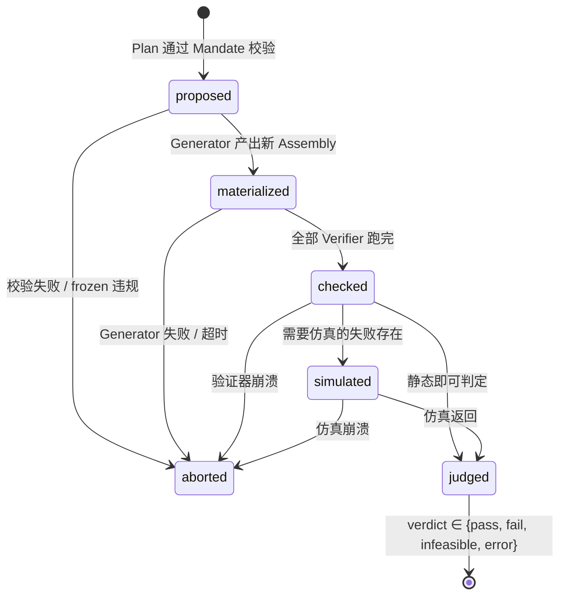
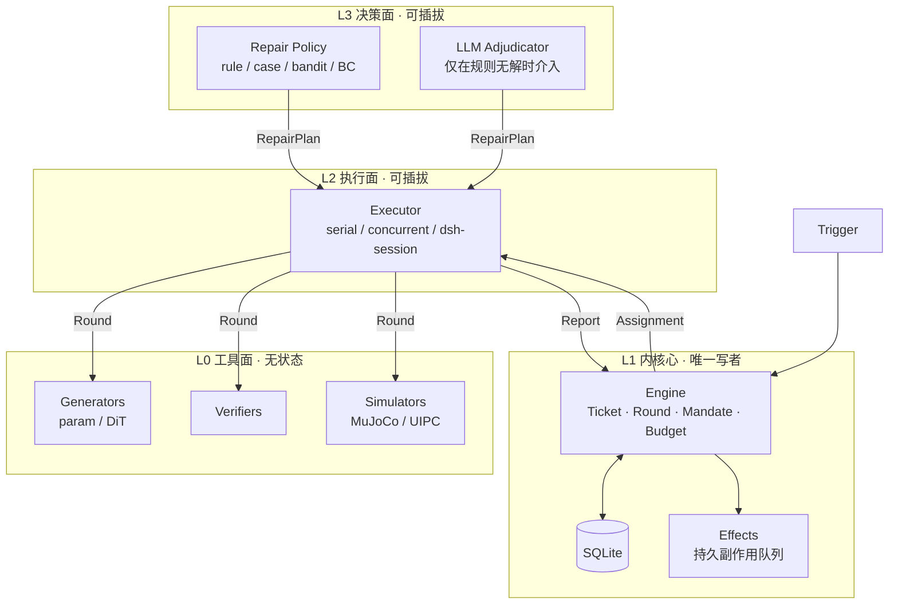

# PAH 开发文档 v1

**Physics-Aware Harness：面向 3D 可装配部件的「证据先于修复」智能体内核**

> 研究所属框架：**Physics-Grounded Agentic Diffusion Framework**。三层与本文的三根支柱一一对应：
> **L1 Physics-Aware Super-Agent**（§4）→ **L2 Physics-Grounded Repair Policy**（§5）→ **L3 Physics-Conditioned DiT**（§6）。
> PAH 是这套框架的**执行底座**：管任务、管状态、管工具、管轨迹、管评测。

版本 v1.0 · 2026-11-01 · 状态：设计定稿，待评审
代号：PAH（Physics-Aware Harness）· CLI 名：`pah` · 仓库：`D:\yanyi\pa-harness`

---

## 0. 一页纸

**建什么。** 一个 Python 内核 + CLI，把「设计稿 → 物理失败 → 诊断 → 修复动作 → 再验证」这个循环变成**有状态、可复现、可批量**的任务系统。内核管任务与证据，三个可插拔点管决策：

| 可插拔点 | 接口 | v0 实现 | 对应论文 RQ |
|---|---|---|---|
| Repair Policy | `propose(assembly, failures, history, budget) -> list[RepairPlan]` | 确定性规则 | RQ2 |
| Operator | 注册表，`apply(assembly, params) -> Assembly` | 参数化几何/连接件算子 | RQ2/RQ3 |
| Generator | `repair(assembly, plan, ctx) -> Assembly` | 恒等 / 参数编辑 / DiT 适配器 | RQ3 |

**不建什么。** 不训 DiT（只定义它的接口与调用协议）；不做通用 3D 生成；不做 CAD 前端；不做 RL 训练（只留轨迹导出）。

**为什么不是照抄 dsh-superagent。** 我们抄的是它的**四个不变量**，不是它的 TypeScript 代码：

1. 内核（`src/core`）零 I/O、纯同步、唯一写者 —— 所以端口化移植到 Python 是忠实的，不是重写。
2. 一次工作 = `Ticket`（授权）/ `Assignment`（执行尝试）/ `Input`（投递）/ `Thread`（话题边界）四个解耦聚合。
3. 所有对外副作用先落库后执行（Effects 表 + `afterCommit`），因此重启不丢工作、不重放。
4. 可读状态由事实**推导**（`ticketStage()` 是纯函数），不存 enum —— 所以崩溃后状态不会撒谎。

**验收（v1 完成判据）。**
- 100 个装配案例的探针可一条命令跑完，产出良率上限与修复成本分布；
- 同一案例、同一预算下，规则策略 vs 随机 vs Best-of-N vs LLM 的对比可跑出等预算曲线；
- 每个 Round 可用 `(case_id, round_idx)` 复现出完全相同的几何 hash 与失败证据；
- 内核单元测试覆盖全部不变量，不需要 GPU、不需要 LLM。

**当前基线数字（来自 2026-10-28 落盘，作为 harness 的起点而非结论）。**

| 环节 | 数字 | 含义 |
|---|---|---|
| 接触边可放连接件 | 705/953 = 74.0% | 剩下 26% 物理上就放不进 |
| 可行边内实体化成功 | 388/705 = **55.0%** → 实测 **393/705 = 55.7%**（见下） | 失败主因 `gap_too_wide` 166 + `no_material_hit` 72（合计 33.8%） |
| 进布尔后成功 | 86.8% | 引擎失败已归零 |
| 整装配完全可解 | 53/100 | 存在连接件生成树的装配数 |
| 门控通过 | 50.0%（12 装配，刚度重标后） | 圆销 41.7% → D 形 66.7% |
| 端到端可用率 | **28.5%**（225 mm） | 探针要抬的就是这个数 |

harness 第一版只回答一个问题：**返修能把 28.5% 抬到多少，代价是多少次仿真、多少次几何工具调用。**仿真不是瓶颈（MuJoCo 739 rollouts/s），**几何工具链才是**（布尔/测厚单装配分钟级）——所以预算的主要维度是几何调用，不是仿真次数。这一点决定了调度器必须给「几何槽」而不是「仿真槽」更高的权重（见 §4.4）。

#### M0 对齐结果（2026-11-01 实测，全量 100 装配）

| 项 | 金标准 | harness 实测 | 差 |
|---|---:|---:|---|
| 总边数 | 953 | 953 | 0 |
| 可行边 | 705 | **705** | **0** |
| 实体化成功 | 388 | **393** | **+5** |
| 成功率 | 55.04% | **55.74%** | +0.7pp |
| 逐边不符 | — | 5 / 705 | — |

**5 条差异全部来自 `asm_000097` 的 id 912/916/917/919/920**，而金标准那 5 条的 `detail` 正是 `exception:MemoryError(Unable to allocate 56/14 MiB)`——即 `connector-boolean-report` §19.5.1 自认的「环境问题而非几何问题」。本次每 worker 只持 1 个装配、内存宽松，5 条都成功；`bool_failed` 因此从 5 变 0，其余 7 类 reason 计数逐项相等（`gap_too_wide` 166、`no_material_hit` 72、`unreatable` 29、`socket_breaks_wall` 17、`peg_detached` 8、degenerate 合计 258）。

**结论与纪律**：
- **可复现基线是 `388/705 = 55.0%`，误差 ±5 条。** 报数时必须写：「393 是几何结果，388 是 2026-10-28 那次运行的环境上限」。
- **不许静默把基线改成 393。** 与既有结论对比时用 388，与后续 harness run 对比时用 393，且两处都要标注这 5 条的来历。
- **M0 遗留项**：必须加内存门槛或对 `asm_000097` 的显式重试，否则每次复现会在 388–393 间浮动——**浮动本身就是不可复现**。
- `--jobs` 在 16 GB 机器上限 **3**；`--jobs 4` 会进 swap（实测前 4 个装配超过 10 分钟未收口）。

---

## 1. 我们从 super-agent 拿什么、丢什么

### 1.1 它到底开源了什么

`dsh-superagent-prototype` 是一个面向单个 GitHub 仓库的主动式编码 agent 原型。把它读薄，只剩四句话：

- **一条事件链**：`Source → Trigger → Thread → Eval → Decision → Ticket → Assignment → Executor → Report → Channel`。每个环节都有明确的幂等键与写入者。
- **一道授权闸**：`Gate`（确定性，判「谁可以开工、以多强的依据」）+ `Assessment`（模型，判「这活该不该接」），产物是不可变的 `Mandate`；`revalidate()` 在恢复前重查。
- **一个持久副作用队列**：`Effects(kind, key)` 唯一行、指数退避、`Later` 表示「现在不能跑」、`generation` 让运行中的旧尝试失效。
- **一条派生式状态机**：`Ticket` 没有 enum，只有 `ended?`；可读状态由 `ticketStage()` 从「最新 Report + 是否有未投递 Input + 是否等人」推导。

### 1.2 概念映射

| 官方概念 | PAH 概念 | 语义变化 |
|---|---|---|
| Source | **Signal Source** | 不再是聊天/PR，而是 5 类物理信号源（见 §3.3） |
| Trigger | **Trigger** | 不可变事件，携带 `design_version` + `part_ids` + `evidence_ref` |
| Thread | **Design Lineage（设计谱系）** | 一个 `assembly_id` 的全部演化历史，是所有反馈的隔离边界 |
| Eval / Gate | **Triage** | 确定性部分扩大：先用物理规则分流，模型只在规则无解时介入 |
| Decision | **Decision** | 取值增加 `repair`（接单修复）、`escalate`（交人） |
| Mandate | **Mandate** | 携带 `scope`（可改部件/区域）+ `frozen`（冻结区）+ `budget`（轮数/仿真次数/墙钟） |
| Ticket | **Repair Ticket** | 一次有边界的修复任务，生命周期含多轮 Round |
| Assignment | **Assignment** | 一次执行器实例绑定，可跨多轮 Round |
| Report | **Round Report** | 载荷从自由文本升级为结构化 `FailureCertificate[]` + `Cost` |
| Channel | **Channel** | 回写位置：CLI 输出、报告文件、面板 |
| Subscription | **Subscription** | 同义：后续仿真/人工反馈可继续喂给同一 Ticket |

**新增实体**：`Assembly`（版本化设计状态）、`GeometryRef`（内容寻址几何）、`FailureCertificate`（结构化失败证据）、`Round`（一次修复尝试）、`Operator`（注册表条目）、`CaseMemory`（跨案例经验）。

### 1.3 三处必须改的语义

**(1) 授权先于执行 → 证据先于修复。**
super-agent 的问题是「凭什么开工」，答案是 `Mandate`。PAH 的问题是「凭什么说它坏了」，答案必须是**验证器签名**。Agent 不能声称存在一个失败——只有注册过的验证器能写 `observed` 字段。这条是防幻觉的唯一硬闸，与 super-agent 用代码而非提示词强制权限完全同构。

**(2) 注意力经济 → 仿真预算经济。**
super-agent 省的是人的注意力（少发消息）。PAH 省的是仿真次数与 GPU 分钟（少跑 MuJoCo）。因此 `Budget` 是一等公民：它进 `Mandate`、进 `Round`、进策略输入、进实验控制。「等预算曲线」不是评估技巧，是内核能力。

**(3) 人触发 → 事件触发。**
super-agent 只在被要求时行动。PAH 的循环由物理失败自己驱动：验证器产出失败即产生 Trigger，不需要人说话。因此 `Eval` 的默认路径是「规则自动接单」，人只在预算耗尽、证据冲突、或需要实物确认时出现。

### 1.4 中心论点

> 把 super-agent 的「授权先于执行」换成「证据先于修复」，把它的「注意力经济」换成「仿真预算经济」，就能把一个面向人类工单的事件系统，改造成一个面向物理反馈的自纠正回路。而这个回路的三个可插拔点（Policy / Operator / Generator），恰好就是论文三个 RQ 的实验旋钮——**系统架构与实验设计不是两件事，是同一件事的两个视图。**

这句话决定了整个文档的组织方式：每一层架构，都必须同时回答「工程上怎么管」和「实验上怎么量」。

---

## 2. 目标、判据、非目标

### 2.1 三个 RQ 对应三个旋钮

| RQ | 问题 | 旋钮 | 内核暴露方式 |
|---|---|---|---|
| RQ1 | 结构化失败知识有用吗？ | 失败表示 | `--failure-representation {raw,nl,certificate}` 三档 |
| RQ2 | Agent 策略优于搜索吗？ | Repair Policy | `--policy {random,rule,bon,llm,case}` |
| RQ3 | 局部生成必要吗？ | Generator | `--generator {identity,param,global,dit}` |
| RQ4 | 架构带来什么？ | Executor / 并发 | `--executor {serial,concurrent}` |

四个开关在 CLI 上是四个枚举，在内核里是四个端口实现。**换 baseline 不改代码。**

### 2.2 必答的五个问题（proposal v0.1 遗留）

1. **表示形式**：v1 只做三角网格（`trimesh` + `manifold3d`），几何以 `(vertices, faces)` 落盘为 GLB/PLY。区域编辑靠**顶点级 mask + 局部坐标系**，不要求 B-Rep。B-Rep/参数化留作 v2。
2. **「可装配」的定义**：分三档，逐档加严，v1 只做前两档。
   - L1 静态无穿透：任意两部件 `min_distance ≥ 0`（碰撞检测）。
   - L2 存在可行装配路径：沿候选方向直线/多段插入，扫掠体不与其它部件相交。
   - L3 力学成立：MuJoCo 装配后稳定 + 连接件贡献度 ≥ 0.10。
3. **修复成本**：见 §6.3 的 `C_edit`。默认权重是占位值，M2 用 100 案例的返修记录标定。
4. **可观测 vs 需推断**：见 §3.4 的「写权限」表——穿透深度可观测，`bore_too_small` 是假设。
5. **如何排除「多采样就能赢」**：等预算曲线（横轴仿真调用数，纵轴成功率），所有策略共享同一 `Budget`，超预算即判负。这是内核级强制，不是分析时的补救。

### 2.3 非目标（v1 明确不做）

- 不训练、不微调任何扩散模型。
- 不做自然语言设计输入（用结构化 `brief.json`，语言留 v2）。
- 不做装配顺序规划器（只做插入方向可行性检查）。
- 不做多人协作/权限系统（单机单用户）。
- 不追求通用 3D 场景——锁定 2–5 部件刚体机械装配。

---

### 2.4 已有资产与复用边界（**先包后写，禁止重写**）

红线：这四份代码共 104 项单测通过，是现有最贵的资产。harness **只能包一层适配器，不能重写内部**；改动算法文件前必须先请示。

| 现有资产 | 位置 | harness 里成为 | 复用什么 / 不动什么 |
|---|---|---|---|
| `connector.py` | `rl_assembly/code/assembly_rl/` | `ConnectorFeasibility` 验证器 + 连接件算子实现 | 12 条 reason 词表原样进 `FailureCertificate.code`；D 形键控参数化不动 |
| `contact_graph.py` + `refine_edges.py` | 同上 | `ContactGraph` 验证器 + 局部坐标系来源 | 五步算法、三级回退、锚点吸附全部保留 |
| `assembly_env.py` + `anticheat.py` | 同上 | `StabilityVerifier` + `AntiCheatGate` | 词典序门控原样；`is_valid()` 硬门禁保留；改的是「谁调用它」，不是它 |
| `mujoco_env.py` | 同上 | `SimBackend` 的一种实现 | rollout 19 ms 的性能不能丢 |
| 10 个 bench 脚本 | `tests/` | `pah probe` 的参照实现 | 流式载入/增量写盘/断点续跑的做法直接抄 |
| 100 装配 + 953 边 | `rl_assembly/data/` | benchmark 输入 + CaseMemory 冷启动 | **只读**，永不写回 |
| `assemblies_pre_decimate/` | 同上 | 布尔与测厚的唯一合法输入 | 用错了会得到不一致数据——这是已知坑 |

**适配器铁律**：适配器只做三件事——参数翻译、返回值翻译、异常翻译。任何「顺手优化」都算改算法，走请示流程。

### 2.5 命名纪律

harness 的名字必须写成「**装配可行性修复 harness**」，不是「通用 3D 修复 harness」。后者在通用指标上已接近零增益，且正面撞 GATOR / Procedura。这既是定位，也是代码注释和论文措辞的约束。

---

## 3. 领域模型

### 3.1 实体与聚合

| 实体 | 角色 | 关键字段 | ID |
|---|---|---|---|
| `Assembly` | 版本化设计状态 | `id, version, parts[], joints[], connectors[], constraints, provenance` | `key('asm', parent_id, patch_hash)` |
| `GeometryRef` | 内容寻址几何 | `hash(sha256), path, format, bbox, volume, n_components` | 由内容决定 |
| `Trigger` | 不可变事件 | `id, source, lineage, at, kind, payload, evidence_ref?` | `key(source, ...)` |
| `Thread/Lineage` | 一个装配的全部历史 | `key, assembly_id, pending[], evaluating?, tickets[]` | `"asm:<id>"` |
| `Decision` | 研判结果 | `id, kind, reason[], mandate?, audit?` | `key('decision', eval_id)` |
| `Mandate` | 授权凭证（不可变） | `scope, frozen, budget, policy_version, basis` | 内嵌于 Ticket |
| `Ticket` | 一次修复任务 | `id, mandate, rounds[], assignments[], inputs[], ended?` | `key('ticket', decision_id)` |
| `Round` | 一次修复尝试 | `id, index, plan, stage, artifacts, evidence[], cost, verdict?` | `key('round', ticket_id, index)` |
| `Assignment` | 执行器绑定 | `id, state, report?, started_at, ended_at` | `key('assignment', ticket_id, n)` |
| `FailureCertificate` | 结构化失败 | `code, locus, magnitude, observed_by, confidence` | `key('fc', round_id, verifier, code, locus)` |
| `RepairPlan` | 修复提议 | `operator, targets[], frozen_check, params, expected, cost_est` | `key('plan', round_id, op, params_hash)` |
| `CaseMemoryEntry` | 跨案例经验 | `signature, operator, outcome{n, success, cost_mean}` | `key('mem', signature, operator)` |

**ID 一律内容哈希**（照抄 `src/core/ids.ts` 的 `key()`）。好处：同一事实重复消费得到同一 ID，幂等免费拿到。

### 3.2 Assembly：版本化设计状态

```jsonc
{
  "id": "asm_000062",
  "version": 3,
  "parts": [
    {"id": "p0", "geom": {"hash": "9f2a...", "format": "glb"},
     "pose": {"t": [0,0,0], "R": [0,0,0,1]}, "mass_kg": 0.06,
     "frozen": true, "role": "host"}
  ],
  "joints": [
    {"id": "j0", "type": "male_female", "a": "p0", "b": "p1",
     "frame": {"origin": [...], "normal": [...]}, "clearance_mm": 0.2}
  ],
  "connectors": [
    {"id": "c0", "family": "d_pin", "joint": "j0", "params": {"r": 0.58, "d": 2.0}}
  ],
  "constraints": {"printer": {"process": "SLA", "r_min_mm": 0.25},
                  "scale_mm": 225, "scale_k": 0.7},
  "provenance": {"parent": "asm_000062@v2", "patch": "plan_a1b2c3"}
}
```

**三种状态必须分开存（混写会被审稿人抓）**：

| 状态 | 谁在用 | 存在形式 |
|---|---|---|
| **生成态** | 生成器、接触图 | N 个分离的水密部件，装配坐标系 |
| **装配态** | 仿真、渲染 | 只在仿真/渲染时临时存在，带连接件实体的合并体 |
| **打印态** | 交付 | 逐件最优朝向 + 编号 + 幅面检查，是唯一可以真的送去打印的东西 |

Round 的 `artifacts` 必须分别记这三种状态的 `geom_hash`，不许只记一个。

**硬规则**：
- `Assembly` 不可变。任何修改产生新版本，`provenance.parent` 指回去。**没有原地修改。**
- `frozen=true` 的部件/特征在修复中禁止改动；违反即 `infeasible`，不进仿真。
- 每个部件带 `role`（`host` / `guest` / `connector`），策略据此决定谁让步（通常让 guest 或 connector 让步，host 不动）。

### 3.3 Trigger 的六类来源

| Source | 触发时机 | 载荷 |
|---|---|---|
| `verifier` | 某个验证器发现失败 | `FailureCertificate[]` |
| `simulation` | 仿真跑完（成功或失败） | `SimulationResult`（trace 引用 + 标量摘要） |
| `human` | 人改了一个参数 / 说「这个不对」/ 说「停」 | `{text, patch?}` |
| `budget` | 预算耗尽 / 墙钟超时 | `{budget_state}` |
| `schedule` | 探针批次的定时任务 | `{case_id, policy}` |
| `import` | 导入外部案例（953 条失败边、HY3D 装配） | `case.json` |

**关键**：`verifier` 和 `simulation` 是自动触发的，不需要人。这是与 super-agent 最大的行为差异——**系统的默认状态是「有事在做」，而不是「等人说话」**。

### 3.4 FailureCertificate：观测 / 假设 / 动作三分

这是全系统最重要的数据结构。proposal 里已经提出，这里把它工程化，并给每一段**写权限**。

```jsonc
{
  "code": "gap_too_wide",            // 受控词表，见下
  "family": "assembly",              // geometry | assembly | structural | manufacturing
  "locus": {
    "parts": ["p0", "p3"],
    "joint": "j7",
    "region": {"type": "vertex_patch", "ids": [1024, 1025, ...]},
    "frame": {"origin": [...], "normal": [...]}
  },
  "magnitude": {"value": 3.2, "unit": "mm", "threshold": 0.2, "direction": "gt"},
  "observed_by": {"verifier": "gap_measure", "version": "0.3.1", "at": "..."},
  "confidence": 1.0,
  "hypotheses": [
    {"text": "bore undersized at +X side", "proposed_by": "llm", "confidence": 0.6,
     "supports": ["resize_bore"], "untested": true}
  ],
  "evidence_ref": {"artifact": "runs/asm_000062/r3/sim.trace.jsonl", "hash": "..."}
}
```

**写权限表（内核强制，不是提示词约定）**：

| 字段 | 谁能写 | 机制 |
|---|---|---|
| `code`, `family` | 验证器 | 受控词表，未注册 code 直接拒绝 |
| `locus`, `magnitude`, `observed_by` | 验证器 | 只有 `verifiers` 注册表里的 id 能提交 |
| `confidence`（观测部分） | 验证器 | 由验证器给出 |
| `hypotheses` | Agent / 人 | 必须标 `untested: true`，不得回写 `observed` |
| `RepairPlan` | Agent / 人 | 必须过算子注册表与 Mandate 校验 |

这条规则是「Agent 不能把未经验证的推断写成物理事实」的**代码级落实**。super-agent 的对应物是：提示词不能改权限，`Gate` 在代码里。

**失败词表 v0（受控，可扩展需改 schema 版本）**：

| family | code | 含义 | 来源验证器 |
|---|---|---|---|
| geometry | `not_manifold` | 网格非水密 | `manifold_check` |
| geometry | `self_intersect` | 自相交 | `manifold_check` |
| geometry | `wall_too_thin` | 壁厚 < 工艺下限 | `wall_measure` |
| geometry | `feature_too_small` | 最小特征 < `r_min` | `print_check` |
| assembly | `interpenetration` | 部件间穿插 | `collision_check` |
| assembly | `gap_too_wide` | 界面间隙超出销跨度 | `gap_measure` |
| assembly | `no_material_hit` | 射线无命中，无可锚材料 | `gap_measure` |
| assembly | `unreatable_too_small` | 可挖空间不足，放不进连接件 | `connector_feasible` |
| assembly | `insertion_blocked` | 插入路径被挡 | `path_check` |
| structural | `disconnected` | 接触图无生成树 | `connectivity` |
| structural | `torsion_free` | 圆销不抗扭 | `torque_check` |
| structural | `load_exceeded` | 质量比过大，吊不住 | `load_check` |
| manufacturing | `overhang` | 悬垂超限 | `print_check` |
| manufacturing | `volume_exceeded` | 超打印幅面 | `print_check` |
| **environment** | `verifier_oom` | 验证器因内存不足未能判定 | 任意验证器 |

**`environment` 族不是物理失败。** 它标记「验证器跑不动」，必须排除在失败率分母之外——这正是 §4.5「工具崩溃不该进失败率」的落地。2026-11-01 实测：`asm_000079:759` 与 `asm_000082:780` 在两次运行中一次 OOM 一次通过，证明这是**间歇性**的，不是几何判据不稳。

词表与 953 条边的实际失败码对齐（`gap_too_wide` 166、`no_material_hit` 72、`unreatable` 64→29 等），迁移时写一个映射表即可，不重造词。

### 3.5 Round：一次修复尝试



- `pass`：全部硬约束满足（L1+L2，或 L3 若开启）。
- `fail`：仍失败，但存在可尝试的算子 → 产生下一轮。
- `infeasible`：冻结区冲突 / 无可行动作 / 预算耗尽 → 交人。
- `error`：工具崩溃 → 与 `fail` 分开统计，**不计入失败率**（否则工具问题会被误读成方法问题）。

**Round 是可复现单元**：`(case_id, ticket_id, round_index)` 三元组唯一确定 `(plan, generator_seed, sim_preset)`，据此可重放出同一 `geom_hash` 与同一证据。

### 3.6 Ticket 阶段推导表

照抄 super-agent 的「推导而非存储」思路，改写条件：

| 阶段 | 条件（从上往下，第一个命中为准） |
|---|---|
| `person/delivery` | Input 投递到执行器失败 |
| `person/answer` | 有 `attention` |
| `person/review` | 最新 Round `verdict=pass` 但需实物确认 |
| `person/blocked` | 最新 Report 是 `blocked` 且其后无新人消息 |
| `person/failed` | 最新 Report 是 `failed` 且其后无新人消息 |
| `person/budget` | 预算耗尽且未 pass |
| `working/queued` | 无 Assignment 或 Assignment=pending |
| `idle` | 最新 Report 是 `waiting`，或 Assignment 已结束 |
| `working` | 其余 |

`person/*` 表示「必须人介入才能继续」。人与 Agent 的界面只有这一个：**面板/CLI 上「等人」的队列**。

### 3.7 Mandate：范围 + 冻结 + 预算

```jsonc
{
  "strength": "explicit",          // explicit | inferred
  "basis": {"via": "human_request" | "rule" | "probe_schedule",
            "rule_id": "auto_repair_on_static_fail"},
  "scope": {
    "parts": ["p1", "p3"],         // 可改部件白名单
    "regions": [{"part": "p1", "type": "bbox", "value": [...]}],
    "operations": ["translate", "resize_interface", "local_regenerate"]
  },
  "frozen": {
    "parts": ["p0"],
    "features": [{"type": "bbox", "value": [...]}, {"type": "hole", "id": "h2"}]
  },
  "budget": {"rounds": 5, "sim_calls": 40, "wall_clock_s": 1800},
  "policy_version": "pv-7f3a"
}
```

**三条不可跳过的检查**（内核在每个 Round 上执行）：
1. `plan.operator ∈ scope.operations`
2. `plan.targets ⊆ scope.parts` 且不与 `frozen` 相交
3. `used.rounds < budget.rounds` 且 `used.sim_calls + plan.est_sim ≤ budget.sim_calls`

违反任一条 → `UserError(code)`，Round 记为 `aborted`，**不落几何**。

### 3.8 不变量清单（逐条可测）

1. `Assembly` 不可变，`version` 单调递增，`provenance.parent` 构成无环链。
2. 只有注册验证器能写 `FailureCertificate` 的观测字段。
3. 任何 Round 的 `plan` 必须通过 Mandate 三项检查。
4. `frozen` 相交 → `infeasible`，且**不消耗仿真预算**。
5. 每轮 `Round` 的 `(case, ticket, index)` 唯一，重放得到同一 `geom_hash`。
6. `pass` 必须由至少一个硬验证器给出，Agent 自评不算。
7. 预算耗尽后不再产生新 Round（只能人解除）。
8. 同一 `Trigger` 重复投递只产生一个 Ticket（内容哈希去重）。
9. 中断的 Assignment 重启后带恢复提示继续，不重复已完成的 Round。
10. `error` 与 `fail` 分开计数，报表中不混。

---

## 4. 支柱一：Agent Architecture —— 生成 / 仿真 / 修复任务怎么管

### 4.1 四层职责



**分工原则（照 super-agent 的 Router/Worker 分离，但换了对象）**：
- L1 只做**记账与校验**：谁能改什么、预算还剩多少、这个 Round 合不合法。不做技术判断。
- L2 只做**执行**：把 Round 跑完，报告结构化结果。不决定修什么。
- L3 只做**选择**：给定证据选动作。不碰几何。
- L0 只做**计算**：纯函数式，可单测，不持状态。

这条分离的直接好处：RQ2 换策略只动 L3；RQ3 换生成器只动 L0；复现实验只固定 L1。

### 4.2 从 super-agent 原样搬来的五条

| 机制 | 原型位置 | 为什么必须照搬 |
|---|---|---|
| **Engine 唯一写者 + 纯同步 + `atomic()`** | `core/engine.ts`、`app/store.ts:140` | 每个命令一个事务；跨部件命令按序调用。并发问题被消灭在结构里，而不是靠锁 |
| **内容哈希 ID** | `core/ids.ts:3-5` | 同一事实重复消费得同一 ID，幂等免费 |
| **Effects 表 + `afterCommit`** | `app/effects.ts:61`、`store.ts:134` | 副作用先落库后执行；崩溃重启不丢、不重放；`generation` 让运行中旧尝试失效 |
| **派生状态而非存储状态** | `core/stage.ts:9-21` | 崩溃后状态不会撒谎；加阶段不改 schema |
| **失败是 Report 的一种，不是新 Ticket** | `model.ts:216` | `blocked/failed` 是「话」，不是状态转移；避免失败把系统炸成碎片 |

### 4.3 为物理域新增的五件

**(1) `Round` —— 循环的原子单位。**
super-agent 的一次 Ticket 对应一个 Session 一段工作。PAH 的一次 Ticket 是**多轮**的，所以必须有 Round。没有 Round 就没有「第几轮、花了多少、上次试了什么」——而这三样正是策略学习的输入。

**(2) `Budget` —— 一等公民。**
进 Mandate、进 Round、进策略签名。三个维度：`rounds`、`sim_calls`、`wall_clock_s`。任一到顶即 `person/budget`。**这是 RQ2「等预算比较」能成立的唯一方式**。

**(3) `EvidenceGate` —— 证据写权限。**
见 §3.4。内核维护 `VERIFIERS: dict[str, VerifierSpec]`，只有注册 id 能提交 `observed_*` 字段。Agent 提交的证据一律降级为 `hypotheses`。

**(4) `OperatorRegistry` —— 动作空间必须是封闭可枚举的。**
否则 LLM 会发明不存在的动作，实验无法复现。注册表版本进 `policy_version`。

**(5) `CaseMemory` —— 跨案例经验。**
super-agent 完全没有这一层（这点很关键：它不学习）。PAH 的「从失败中学习」落在这里，不在提示词里。

### 4.4 并发模型

三个独立配额，都靠「同步预留 + `Later` 推迟」实现，不靠阻塞：

| 配额 | 默认 | 保护谁 | 满了怎么办 |
|---|---|---|---|
| `worker_slots` | 4（人消息 +1） | CPU/进程 | Effect 抛 `Later`，5s 后重试 |
| `sim_slots` | 2（MuJoCo CPU 每槽 1 进程） | CPU 核 | 同上 |
| `gpu_slots` | 1（生成模型独占） | 显存 | 同上 |

**关键细节（照抄 `WorkerSlots.reserve()`）**：预留是**同步**的，在 `executor.start()` 里立刻占位，不留竞态窗口。人的请求永远能用额外的一槽——否则批量探针会把交互饿死。

### 4.5 失败、恢复、重试

| 情形 | 处理 | 依据 |
|---|---|---|
| 瞬时错误（OOM、显存争用、文件锁、网络） | 重试 3 次，指数退避 5s→300s | 照抄 `dsh.ts:29` |
| 确定性失败（frozen 违规、算子不存在） | **不重试**，记 `aborted` + `UserError` | 重试不会变好 |
| 工具崩溃（验证器/仿真器异常） | 记 `error`，不进失败率；连续 3 次报 health | 防止工具问题污染方法结论 |
| 进程崩溃 | 重启后 `assignmentInterrupted`：running → 带恢复提示重开，从最近 `closed` Round 继续 | 照抄 `assignments.ts:83-92` |
| 生成结果与上一轮同 hash | **环检测**，回滚并 `infeasible` | 物理域特有：策略可能反复提议同一修改 |
| 预算耗尽 | `person/budget`，保留全部证据，等人决定加预算或放弃 | — |

**恢复提示模板**（照抄 `RECOVERY_NOTE` 的思路，换领域词）：

```
This assignment was interrupted. Before repeating any work:
1. Read the ticket's round history: rounds/<n>/plan.json and report.json
2. Read the latest assembly version and its geom hash
3. Do NOT re-run a round whose index already exists
4. Continue from the first round with no verdict
```

### 4.6 Executor 三种实现

```python
class Executor(Protocol):
    def start(self, ticket: Ticket, assignment: Assignment) -> None:
        """Queue a launch; report back via engine.assignment_started / report."""
    def deliver(self, ticket: Ticket, assignment: Assignment) -> None: ...
    def stop(self, ticket: Ticket, assignment: Assignment, reason: str) -> None: ...
```

| 实现 | 何时用 | 一轮耗时 | 需要 GPU |
|---|---|---|---|
| `SerialExecutor` | 单案例调试、上帝返修探针 | 秒级 | 否 |
| `PoolExecutor` | 100 案例批量、baseline 矩阵 | 秒级 × N 进程 | 否 |
| `DshExecutor` | 需要多步调查、读论文/文档、写报告 | 数十秒 | 否 |

三者共用同一 `RepairPolicy` 与同一 `Generator`。**换 Executor 不改策略，换策略不改 Executor**——这是 RQ4 能单独归因的前提。

### 4.7 为什么内核不依赖 DSH session

三个理由，按重要性排：

1. **批次基线必须无 LLM 可跑。** RQ2 的 `random` / `rule` / `best-of-n` 三个 baseline 如果还得起一个 agent session，就既慢又不可比。内核必须是纯 Python 同步库，`pah probe` 一条命令跑完 100 例。
2. **单轮成本。** 100 案例 × 5 轮 × 4 策略 = 2000 轮。session-per-round 每轮多 5–10 s 建会话与工具调度开销，合计 3–5 小时纯浪费；纯函数调用一轮 0.2–2 s。session-per-ticket 可以接受，但不是第一版必需。
3. **可复现。** 同一 `(case, round, seed)` 必须给出同一几何。LLM 的温度、系统提示版本、模型版本都要能钉住；内核不管这些，只记 `model_id + prompt_version + seed` 进 Round。

**DSH 的正确位置**：不是内核，是**外挂的「研究员」**——用它读文档、写分析、跑长调查、生成 case。内核不认识 DSH，DSH 通过 CLI 调内核就够了。

---

### 4.8 L0 工具面的可信度契约（**本设计最容易被忽略、代价最大的一层**）

整个循环优化的是验证器的输出。**验证器说谎，循环就会高效地学习错误的东西。** 现有数据里已经有四种「验证器说谎」的实例，每一种都必须在架构层堵死：

| 陷阱 | 表现 | 架构对策 |
|---|---|---|
| **假稳定 #1：穿模卡住** | 深穿插的装配「几乎不动」，被判为最稳 | 仿真结果必须同时报 `IVR`（interpenetration volume ratio）；`IVR > 0` 时稳定性分数置为无效，不是打折 |
| **假稳定 #2：`is_valid()` 静默空操作** | `is_valid()=False` 时 advance 不做事，末态≈初态，`Δp≈0` 被读成最稳 | **`is_valid()` 是硬门禁**：False 直接丢弃该样本，**绝不记 0 位移**，记 `invalid_sample` 进独立计数桶 |
| 初始穿模被引擎直接拒 | 恰好接触（`y_min=0`）即 `is_valid()=False` | 装配态进入仿真前必须做 `epsilon` 预处理留缝；这一步失败记 `precondition_failed`，不算物理失败 |
| 元数据不可信 | `meta.json` 的 `residual_overlap_pairs` 5 个装配全报 0，UIPC 实测每装配 1814–55766 条三角形相交 | **禁止直接读元数据当校验**；任何交叠量必须由验证器现场算 |

**2026-11-01 代码核查：这张表不是假想，其中一条已经确证存在于现有实现里。**

| 已确证的实现缺陷 | 位置 | 后果 |
|---|---|---|
| `AssemblyEnv.parts_info()` 把 `ivr` **硬编码为 0.0** | `assembly_env.py:784` | 门 1 的穿模检查在真实数据上**永不触发**；现有 55.0% / 86.8% / 28.5% 三个数字**都不含穿模惩罚** |
| `is_valid()` 只存在于 UIPC 路径 | `research/uipc_asm_validity.py:108` | MuJoCo 侧根本产生不了 `invalid_sample` 桶，§4.8 第 2 条对策在 MuJoCo 后端是空转 |
| `edges_v2.json` 键名 `center_mm`/`anchor_mm` + 毫米制，而 `edges_from_records` 只读 `center` | `data/asm_io.py`、`assembly_env.py` | 缺省静默变成 `[0,0,0]`：所有 peg 装到原点，**仿真照样跑完不报错**——最隐蔽的一种失败 |
| `unit_mm` 两条路径不一致：`connector.infer_unit_mm = 225/最长边 = 1000`，而 `tests/asm_bench.py:67-70` 用 `meta["scale"]×1000 ≈ 118` | `connector.py` vs `tests/asm_bench.py` | 差 8.5×，`r_min` 被放大，可行边被判不可行 |

**2026-11-01 全对扫描修正了上表第一行的判断（`ivr` 硬编码 0.0）**：

- **交付集**（`assemblies_pre_decimate`，100 装配 / 722 部件 / 2992 对，bbox 剔除 2022 对后精确算 970 对）：`ivr_assembly` p50 = 0、p90 = 1.25e-19、max = **1.708e-13**；14/100 非零，**全部落在 `(0, 1e-6]` 浮点噪声档**；`> 1e-6` 的 **0 个**；**`unknown` 0 对**。最大单对 `asm_000080 part_002–part_009` = 2.84e-17 m³，约边长 0.003 mm 的立方体，是近相切界面的布尔残渣。
- **记忆卡「侵入量中位 1%–3%」并没有错，它说的是裁剪前。** 同一扫描器在 `data/objects/<id>/part_*.ply` 上给出 **0.92%–3.09%**（p50 2.8%），而同样 5 个装配的交付件 ≤ 3.2e-19。差别只在布尔裁剪这一步；「83% 表面在另一件内」那条属于生成侧被 `s5_no_overlap` 丢弃的样本，不在交付集。
- 所以 `ivr = 0.0` 硬编码在这批数据上**恰好不出错**——这是「两个错误互相抵消」。但**换一批未裁剪的数据就会静默失效**，这才是它必须被修掉的真正理由。

**A = 0 不等于装配物理合法。** IVR 是体积量，看不见「零间隙精确共面」，而那正是 UIPC `is_valid() = False` 的实测根因。所以还需要一条**间隙判据**（部件两两最小距离的分布），它与 IVR 是两条独立的门。**只报 IVR 就宣布「数据合法」是把一个维度当成了全部。**

#### 间隙扫描结果（2026-11-01）：数据集是「实体的分区」，不是「有间隙的装配」

100 装配 / 722 部件 / 2992 对，unknown **0**（AABB 扩张另证明 1996 对 > 0.5 mm）：

| 最小距离档 | 对数 | 占比 | 涉及装配 |
|---|---:|---:|---:|
| **= 0（精确接触）** | **898** | **90.16%** | **100 / 100** |
| (0, 0.001] mm | 0 | 0 | 0 |
| (0.001, 0.01] mm | 0 | 0 | 0 |
| (0.01, 0.1] mm | 2 | 0.20% | 2 |
| (0.1, 0.5] mm | 37 | 3.71% | 18 |
| > 0.5 mm | 59 | 5.92% | 28 |

**分布是双峰的，没有中间态**：要么精确贴死，要么在 0.01 mm 以外。这是布尔裁剪的指纹——部件是从同一个水密实体上切下来的，**切面天然精确重合**。

**这不是数据没清理干净，是数据的构造方式决定的。** 它同时解释了四件此前分开看的事：

1. 体积 IVR 恰好为 0 —— 分区不重叠；
2. 间隙恰好为 0 —— 切面重合；
3. 两套独立扫描互证：体积为 0 的 973 对里 875 对（89.93%）间隙精确为 0；而 23 对**非零体积残渣**的对，**23/23 间隙也恰好为 0**（近相切界面的布尔噪声）；
4. `gap_too_wide` / `no_material_hit` 成为两大失败码 —— 因为连接件要跨的是一条**被切开的零间隙缝**，而不是一条真实装配里本就存在的间隙。

**后果（必须写进论文的评测协议）**：

- **100/100 个装配都会被 UIPC 拒收**（`y_min = 0` 即 `is_valid() = False`，整个 world init 不过）。epsilon 留缝是**必需项**，不是可选项。
- **「可装配」的定义在这份数据上是不自洽的**：分区的正确性要求间隙 0，装配的可行性要求间隙 > 0。两者不能同时满足，所以任何基于这份数据的「可装配率」都必须先声明用哪一套。
- 修法的最小候选是**在装配态统一注入 epsilon 间隙**（沿切面法向偏置），并在 `manifest` 里钉死 epsilon 与偏置方向；这属于**评测配置**，与 `policy_version` 一起冻结。

**这也把 M1 的结果放到了正确的位置**：73.3% 的边级良率是在「零间隙分区」上测出来的，它衡量的不是真实装配的可装性，而是**在无间隙几何里能不能造出一个跨得过切缝的连接件**。这个口径可以保留，但必须改名或加脚注，否则会被读成「可装配率」。

**2026-11-01 实测反转：`1000` 与 `118` 都不对。** 上文我一度写下「权威口径是 1000」，是错的。在 `assemblies_pre_decimate`（150 mm 基准帧）上做三口径对照（5 装配、38 条可行边、逐边比对金标准 `_final_rows_Nnew_Tnew.json`）：

| 口径 | 实测 `unit_mm` | 成功 | 与金标准逐边不符 |
|---|---:|---:|---:|
| **`225 / longest_side`（正确）** | **1500.0** | **24 / 38** | **0 / 38** |
| `1000`（米→毫米） | 1000 | 20 / 38 | 8 / 38 |
| `meta["scale"] × 1000` | 76.2 | 4 / 38 | 22 / 38 |

原因：`edges_v2.json` 的**派生长度**写在 225 尺度，**坐标**写在 150 基准帧；而布尔与测厚必须用 `assemblies_pre_decimate`，那里 1 个数据单位 = 225 尺度下的 1500 mm。所以必须**两个除数分开**：坐标除固定 `COORD_MM_PER_UNIT = 1000`，派生长度除 `unit_mm`。混用正是本节警告的「两套尺度混用」。

教训写在这里：`unit_mm` 不是可以推理出来的常量，是必须逐边对齐金标准才能确定的**测量**。M0 的对齐验收因此不是形式主义——它抓出了两个错误的「显然结论」。

这三条直接改变了 M0 的验收口径：**复现 388/705 只是第一步，还要同时产出「加上 IVR 惩罚后的数字」**，否则 harness 会把一个已知有洞的基线当成地板。

#### IVR 规格（2026-11-01 拍板：由 harness 自己算，两级）

定义固定为：

```
IVR = Σ_{(i,j) ∈ E_check} Vol(V_i ∩ V_j)  /  Σ_i Vol(V_i)
```

`V_i` 是部件 `i` 的实体占据体积，`E_check` 是需检查的部件对。**必须明确排除合法的设计重叠**（例如按键配合的过盈量），且不得重复统计同一对。

| 级别 | 方法 | 用途 | 输出字段 |
|---|---|---|---|
| **Fast** | 包围盒剔除 → 占据体积采样（优先）或表面采样（次选） | **只补 exact 判不了的对** | `penetration_probe` |
| **Exact** | 实体布尔交集体积（`manifold3d`） | **每个 Round 都跑** | `ivr_exact` |

**频次反直觉，实测后再定（2026-11-01）**：在闭合件上 `ivr_exact` 比 `ivr_probe` **快 14–20 倍**（2 万面 0.055 s vs 1.12 s；1.3k 面 0.007 s vs 0.10 s）——瓶颈是 trimesh 的射线内核约 1 ms/条，不是包围盒剔除。所以：

- **per-Round 直接跑 `ivr_exact`**，每对约 55 ms，远小于布尔分钟级的量级；
- `probe` 只在 exact 返回 `unknown` 时补证据，**不进训练内循环**；
- 表面采样模式**只当证据、不当裁决**。

三条硬规则（**都来自「采样近似不能等同于不存在穿模」这条约束**）：

1. **Fast 级如果只能做表面采样，字段名必须是 `penetration_probe`，不许叫 `ivr`。** 表面采样对薄壁、完全包含件、局部微小穿透会漏检，直接叫 IVR 就是把估计当测量。
2. **精确布尔跑不了的非流形网格，返回 `unknown`，绝不默认 0。** 默认 0 等于把「不知道」记成「没穿模」。
3. **任何报表必须分开报三个数**：`success_original`、`success_ivr_validated`、`ivr_unknown_count`。不能只报前两个。

#### `unknown` 的处置：两个消费者，两套策略（2026-11-01 加固）

`unknown` 的含义是「布尔工具**无法可靠判定**两个实体是否相交」，**不是**「两个实体不相交」。所以它在系统里被两个不同的消费者读取，必须给两套不同的策略：

| 消费者 | 策略 | 理由 |
|---|---|---|
| **决策环**（是否进入下一轮 / 是否收工） | `unknown` → **视为未通过** | 防止 Agent 学会「制造不可判定」来逃避门禁。让检查器失效是一种作弊面，和让仿真分数变高是同一类 |
| **报表**（论文与实验结论） | `unknown` → **独立桶 + 给上下界** | 不能把「不知道」算成通过，也不能静默算成失败 |

报表的正式写法是**区间**，不是点：

```
lo = success_original ∧ (ivr_exact ≤ ε)                       # unknown 记为未通过
hi = success_original ∧ (ivr_exact ≤ ε  ∨  ivr = unknown)     # unknown 记为通过
report: success_ivr_validated ∈ [lo, hi]   , unknown = n_unknown
```

**区间宽度本身就是结论**：如果 `[lo, hi]` 宽到 20 个点，说明几何工具链撑不住这个评测口径，此时该做的是修工具（换布尔引擎、预处理非流形），而不是挑一个端点点交差。

三条防 gaming 的附加约束：

- Agent **不能影响** IVR 的阈值 `ε`、布尔引擎容差、或采样密度——这些属于评测配置，与 `policy_version` 一起冻结。
- 同一装配的 `unknown` 率进入风险报表；若某类修复策略的 `unknown` 率显著高于其它，先按「疑似规避检查」审查，再讨论效果。
- `unknown` 数超过总样本 10% 时，该 run **不得**用于论文主结论，只能作探索性结果。

#### 三类穿透统计必须分开报（2026-11-01 要求）

| 类 | 含义 | 谁产出 | 用途 |
|---|---|---|---|
| **A 原始装配穿透** | 数据集自带，修复前就存在 | `pah verify ivr-scan`（全对两两） | 判断基线是否物理合法 |
| **B 修复新增穿透** | 相对 A 的增量 | Round 的前后 diff | 判断修复有没有制造新错误 |
| **C 连接件实体化成功** | 393/705 | `pah probe connector` | 工程结果，保留不动 |

**A 不是 B 的分母，B 不是 C 的修正项。** 三个数各自独立成立。混在一起就会得出「修复提升了良率」而实际是「修复把穿模换了个位置」这类结论——这正是 §9.8「不许一个物理指标换另一个」在度量上的落地。

M0 的验收因此是三条，不是一条：

- 复现 `388/705 = 55.04%`；
- IVR 检查接口就位（Fast 级可用，Exact 级至少能对 5 个装配跑通）；
- 明确报出 `[lo, hi]` 与 `n_unknown`，且 `unknown` 不被静默并入 pass 或 fail。

**`unit_mm = 1000` 不是常量，是断言。** 必须在 `pah case build` 时验证：`max_edge_length_mm ≈ 225 × (最长边归一化) `，对不上直接抛错，不许静默降级。

**运行前自检（`pah verify sanity`）**：每个验证器注册时必须带 `fixtures: {known_bad: [...], known_good: [...]}`。内核在 `pah` 启动、以及每次 `policy_version` 变更时跑一遍自检：

```
verifier 自检 = 全部 known_bad 判负 ∧ 全部 known_good 判正
任一不过 → 该验证器 disabled，health 报 error，票进入 person/blocked
```

**这条把「单测」从开发期纪律升级成运行期准入门槛。** 现有 104 项单测里的关键几条（门控词典序、`is_valid` 拒样本、反重力检验）直接变成 fixture。

**验证器级联（先便宜后贵）**：

```
manifold_check (ms)  →  wall_measure (100ms)  →  connector_feasible (s)
                     →  gap_measure (s)       →  collision/path (s)
                     →  MuJoCo (10-20ms/装配)  →  UIPC (秒级，仅正式裁决)
```

规则：上一级判负就不跑下一级；`cost_class` 进 Round 的 `cost` 记账。这既省时间，也让「失败发生在哪一级」成为可分析的信号——大量案例死在 `connector_feasible`，说明瓶颈在几何工具链而不是物理。

---

## 5. 支柱二：Decision Making —— 如何根据物理失败决定下一步

### 5.1 四层决策漏斗

```
FailureCertificate[] ──┐
                       ▼
 ① Triage（确定性）    : 可修? 需人? 见过?
                       ▼
 ② Candidate（确定性） : 失败码 × 部位 → 算子候选（多对多表）
                       ▼
 ③ Rank（统计）        : CaseMemory 经验 + 成本模型 → 排序 + 剪枝
                       ▼
 ④ Adjudicate（模型）  : 仅当 并列/空/新码 才调 LLM
                       ▼
                   RepairPlan
```

**为什么这样切**：每一层都可以单独关掉做消融。
- 关 ④ → 纯规则策略（RQ2 的 `rule` baseline）
- 关 ③④ → 随机策略（`random`）
- 只开 ②④、候选全采样 → Best-of-N
- 全开 → 完整策略

**LLM 只在第 4 层出现**，这是整个决策设计的核心约束。它带来三个可验证的后果：
- 90% 的轮次不花 LLM token（成本可控）
- 规则覆盖的部分完全可复现
- LLM 的价值可以被单独度量（只看它介入的 10%）

### 5.2 算子注册表

```python
@dataclass(frozen=True)
class Operator:
    id: str
    family: Literal["geometry", "interface", "connector", "generative"]
    params: type[pydantic.BaseModel]
    preconditions: tuple[Callable[[Assembly, FailureCertificate], bool], ...]
    apply: Callable[[Assembly, dict], Assembly]
    targets: Callable[[dict], list[str]]       # 影响哪些部件
    cost_class: Literal["cheap", "medium", "expensive"]
    reversible: bool
```

**v0 算子表（18 个，v1 冻结）**：

| family | id | 参数 | 主要作用于 | cost |
|---|---|---|---|---|
| geometry | `translate_part` | `part, delta[3]` | interpenetration, insertion_blocked | cheap |
| geometry | `rotate_part` | `part, axis, angle` | insertion_blocked, overhang | cheap |
| geometry | `scale_part` | `part, factor` | gap_too_wide | cheap |
| geometry | `chamfer_edge` | `edges[], r` | insertion_blocked, overhang | cheap |
| geometry | `fillet_edge` | `edges[], r` | wall_too_thin(局部) | cheap |
| geometry | `offset_shell` | `part, delta` | wall_too_thin | medium |
| interface | `resize_interface` | `joint, dr, dd` | gap_too_wide, unreatable | cheap |
| interface | `move_interface` | `joint, anchor_xyz` | gap_too_wide, no_material_hit | cheap |
| interface | `add_clearance` | `joint, mm` | interpenetration | cheap |
| interface | `split_part` | `part, plane` | unreatable_too_small | expensive |
| interface | `merge_parts` | `parts[]` | disconnected | expensive |
| connector | `resize_connector` | `conn, dr, dd` | gap_too_wide, wall_too_thin | cheap |
| connector | `relocate_connector` | `conn, anchor_xyz` | no_material_hit, gap_too_wide | cheap |
| connector | `swap_family` | `conn, family` | torsion_free, unreatable | cheap |
| connector | `add_connector` | `joint, family, params` | disconnected, torsion_free | medium |
| connector | `remove_connector` | `conn` | wall_too_thin, print fail | cheap |
| generative | `dit_local` | `region_mask, freeze_mask, cond` | 任意（兜底） | expensive |
| generative | `dit_part` | `part, cond` | 结构性问题 | expensive |

**9 类可打印连接件**是 M1 的交付物（当前清单是候选，由工艺约束链定稿）：圆销、D 形销（抗扭）、燕尾、榫槽（box/finger）、卡扣（snap-fit）、螺纹/自攻、铰链销、夹持/卡箍、嵌件位。每类暴露 `params` + `feasible(half_w, half_h, t_b, r_min)` 判定，直接复用已有的 `r_eff = min(0.5·r_inplane_raw, t_b/2.25)` 约束链。

### 5.3 Policy v0：确定性规则表

失败码 → 算子优先级（左高右低）。这张表是**可编辑配置**，不是硬编码。

| 失败码 | 算子优先级 |
|---|---|
| `gap_too_wide` | `resize_interface(+r)` → `relocate_connector` → `swap_family(更大)` → `dit_local` |
| `no_material_hit` | `relocate_connector` → `add_connector` → `resize_interface` → `dit_local` |
| `unreatable_too_small` | `swap_family(更小)` → `move_interface` → `remove_connector` → `split_part` → `dit_local` |
| `wall_too_thin` | `offset_shell` → `resize_connector(-r)` → `remove_connector` → `dit_local` |
| `torsion_free` | `swap_family(D形)` → `add_connector(错轴)` → `dit_local` |
| `disconnected` | `add_connector` → `merge_parts` → `dit_local` |
| `load_exceeded` | `add_connector` → `swap_family` → `scale_part` → `dit_local` |
| `interpenetration` | `add_clearance` → `translate_part` → `resize_interface` |
| `insertion_blocked` | `rotate_part` → `translate_part` → `chamfer_edge` → `dit_local` |
| `not_manifold` / `self_intersect` | `dit_local`（参数算子救不回） |
| `overhang` | `rotate_part` → `chamfer_edge` → `dit_local` |

**参数怎么定**：每个算子带一个 `param_policy`，v0 用**闭式解 + 边界钳制**。例：`gap_too_wide` 的 `resize_interface` 直接令 `dr = gap_measured/2 + clearance_target`，再钳到 `r_eff` 上限。这一步不需要学习，也不需要 LLM——**先把能算的算掉，剩下算不出的才交给模型**。

### 5.4 Policy v1：案例检索 + 上下文 bandit

**签名（signature）**——失败的可比较表示：

```
sig = hash(
  sorted(failure_codes),
  n_parts_bucket, bbox_diag_bucket, mass_ratio_bucket,
  joint_type_multiset, limiter_multiset,      # wall | in_plane
  gap_magnitude_bucket, wall_thickness_bucket
)
```
分桶用固定边界（写进配置），避免浮点导致签名爆炸。

**打分（UCB1）**：

```
score(op) = mean_success(op) + c * sqrt(ln(N_total) / n_op)
          - λ_cost * normalized_cost(op)
```

**冷启动**：953 条失败边（失败原因 = 返修动作标签）直接灌进 CaseMemory，`n_op` 初值不为 0。这是现成的、最值钱的一份监督信号，不用等实验。

**检索**：`codes` 用 Jaccard，连续桶用 L1，取 top-k 邻居后按邻居内的算子成功率重排。k=20 起步。

### 5.5 学习阶梯：四阶段，DiT 全程冻结到第三阶段末

这是整个研究最关键的归因设计——**如果同时训 Agent 和 DiT，就无法判断提升来自策略还是生成能力**。

| 阶段 | Agent | DiT | 要验证什么 | harness 侧要提供什么 |
|---|---|---|---|---|
| **S1** LLM inference-time | 预训练 LLM 直接选动作 | 冻结（或未接入） | 物理反馈能否被理解成有效修改指令 | Round 记录 + 四层漏斗 |
| **S2** Experience-guided | LLM + CaseMemory 检索 | 冻结 | 经验检索能否提升修复效率 | `memory` 表 + 检索接口 |
| **S3** Learning-based | BC / Offline RL | 冻结 | 学习型策略是否优于零样本 LLM | 轨迹导出（`(s,a,r,s')`） |
| **S4** Joint | 学习型 Agent | 条件化微调 | 协同优化是否还有增量 | 条件 schema 版本管理 |

**S1 与 S2 的区别必须说清楚**：S1 只有当前上下文推理，模型参数没变；S2 是检索增强，参数同样没变。**只有 S3 才叫「学习」**。论文里把 S1/S2 说成「学习」是审稿人第一个会打的点，所以在 harness 的 report 里，这三档要分开打标签（`policy=llm` / `policy=case` / `policy=bc`），不能混成一个 "agent"。

**S3 的两个陷阱**：
- BC 的输入分布来自弱策略，会把弱策略的偏差固化；100 案例的规模上极易发生。所以 BC 只在 S2 已经跑出稳定轨迹之后做。
- Offline RL 的奖励必须防漏洞：`r = α·ΔQ_physics − β·C_edit − γ·C_sim`，而 `ΔQ_physics` 若只由仿真器给分，模型会学会「破坏原始功能来消除碰撞」。对策：**任务功能、连接拓扑、关键尺寸必须作为独立约束或独立评价指标，不能混进同一个加权和**（词典序门控，不是加权和）。

### 5.6 停止判据（硬编码，四条）

1. `verdict == pass`
2. 预算任一维耗尽
3. 无算子通过前置条件（所有 `preconditions` 为 false）
4. 环检测：新 `geom_hash` 命中历史 → 回滚该分支
5. **期望收益判据**：`P(success|op) * value - cost_est < 0` → 停

第 5 条是「最小修改成本」在决策层的体现：不是「能不能修」，是「值不值得修」。

### 5.7 LLM 的边界（写进代码，不写进提示词）

| 能做 | 不能做 |
|---|---|
| 在给定候选集里选一个并给理由 | 发明算子 |
| 在规则无解时提出新的算子组合 | 声称某处「有物理失败」 |
| 把自然语言设计意图转成约束 | 越过 frozen 区 |
| 诊断「为什么这条规则不适用」 | 修改预算或 scope |
| 写实验报告、失败案例分析 | 直接写几何顶点 |

形式上：LLM 的输出类型是 `RepairPlan`（pydantic 校验）+ `Hypothesis[]`。**没有任何一个 LLM 输出类型包含 `observed` 字段**——这是类型系统层面的保证。

---

## 6. 支柱三：Generative Modeling —— 如何根据反馈精确改局部

### 6.0 先说清楚：现在没有 DiT

全盘核查（2026-10-26）：没有 hunyuan / trellis / tripo 的仓库或权重；HF 缓存 12.2 GB 里没有任何 3D 生成模型。`D:\biye_sheji\ddpm` 是自写 DDPM/LDM，**图像域**。所以：

> **「DiT 出粗件」目前是愿景，不是资产。** 能拿到的「粗件」实际上是 HY3D-Bench 里别人已经生成好的 part 网格。

这条不是坏消息，它把设计约束说得更清楚：**Generative Modeling 这一支柱必须做成「接口 + 可替换后端」，不是「一个模型」。** 2026-11-01 拍板的口径是：

> **预训练 DiT + 局部条件化编辑，初期冻结，通过 API 调用。** DiT 只负责几何，Agent 只负责策略。

所以后端分层从「有没有模型」变成「控制精度有几级」：

| 档 | 后端 | 何时用 | 控制精度 |
|---|---|---|---|
| G0 | `ParametricBackend`：算子注册表直接改几何 | M0–M2 主力，建立物理修复基线 | **Parameter-level**（精确、可复现） |
| G1 | `CaseResampleBackend`：换物体 / 换 seed / 回滚版本 | 承担「回退重生成」，让闭环完整 | 离散 |
| G2 | `ApiDiTBackend`：调预训练 DiT（HTTP），冻结权重 | M3 起接入 | **Parameter + Spatial 混合** |

**为什么先 G0 再 G2**：proposal 的顺序（A → B → C）不是保守，是归因需要。先在「几何被完全控制」的条件下把物理修复基线做扎实，接 DiT 之后任何提升才能归因到「控制能力」而不是「模型本来就会」。

#### Agent 如何控制 DiT：Parameter-level + Spatial-level 混合（拍板）

| 控制层 | Agent 输出什么 | 精度 | 能否单独作为 v1 方案 |
|---|---|---|---|
| Prompt-level | 自然语言描述 | 低，局部保持能力弱 | 否 |
| **Parameter-level** | 接口尺寸、位姿、连接类型、间隙目标 → 几何编码器转条件 | 高 | 是（G0 就是这个） |
| **Spatial-level** | 局部编辑区域 mask、接触约束、碰撞场、未编辑区冻结 mask | 高 | 是（G2 的输入） |

v1 的 `RepairPlan` 已经是 Parameter-level 的完整载体（§8.2）；G2 接入时在同一个 plan 上加 `region`/`frozen_mask` 两个字段即可，**不需要新的决策类型**。这是接口设计的最大好处：Agent 的策略空间不随生成器变化。

`target_clearance_mm` 这类参数**不许写死**，必须由 `constraints.json` 的工艺与配合要求推出来（SLA 与 FDM 的合理间隙不同，过盈配合与间隙配合也不同）。

**「回退重生成」必须是闭环的一部分**（否则只是替缺陷输入修补，上限被生成器锁死），但 v1 的回退**由 G1 承担**——换物体、换 seed、回退到上一个 Assembly 版本。这三件事都不需要新模型。

### 6.1 Generator 协议

```python
@dataclass
class GenContext:
    region_mask: np.ndarray | None      # 顶点级，可编辑区
    freeze_mask: np.ndarray | None      # 顶点级，禁止改动
    conditioning: dict                  # 见 §6.2，JSON 可序列化
    seed: int
    budget_hint: dict

@dataclass
class GenResult:
    assembly: Assembly
    model_id: str
    seed: int
    report: dict                        # 模型自报信息（不参与判定）
    cost: dict                          # 耗时/显存/token

class Generator(Protocol):
    id: str
    def repair(self, asm: Assembly, plan: RepairPlan, ctx: GenContext) -> GenResult: ...
```

四个实现：

| id | 行为 | 用途 |
|---|---|---|
| `param` | 调算子注册表的 `apply` | **v1 主力**，全覆盖，无 GPU |
| `resample` | 换物体 / 换 seed / 回退版本 | 「回退重生成」的 v1 实现 |
| `dit` | 调外部模型（Fake 先行） | DiT 到位后接入 |
| `global` | 整件重生成 | **只作消融，禁止作为默认**（见下） |

**禁止整件替换**（借 GATOR 的硬规则，写进内核而不是提示词）：

- `global` 与 `dit` 若输出与输入的**非目标区保留度**低于阈值，直接判 `aborted`，不进物理验证。
- 禁止「重新对齐全局坐标」「贴地」「整件缩放」这三类动作——它们在数据上会造成虚假的通过。
- 每个 Round 必须能回答「你改了哪几个部件的哪几个顶点」，答不上来即判非法。

**关键**：所有后端实现同一协议，所以 RQ3 的对比是「换一个类」，不是「换一套流程」。

### 6.2 条件接口（与具体 DiT 解耦）

条件必须是**模型无关的规范表示**，适配器负责翻译：

```jsonc
{
  "failure": [{"code": "gap_too_wide", "joint": "j7", "magnitude_mm": 3.2}],
  "target": {"part": "p1", "role": "guest"},
  "region": {"type": "vertex_patch", "ids": [1024, ...], "bbox": [...]},
  "frozen": {"parts": ["p0"], "vertex_ids": [...]},
  "constraints": {
    "r_min_mm": 0.25, "t_b_mm": 1.2, "clearance_mm": [0.15, 0.30],
    "printer_volume_mm": [180, 180, 180], "process": "SLA"
  },
  "preserve": {"target_chamfer_mm": 0.05}
}
```

适配器把这份 JSON 翻成 DiT 的 cross-attention 条件 / 区域 mask / 点云提示。**换 DiT 只改适配器。**

### 6.3 最小修改成本

```
C_edit(A', A0) =
    w_v * |ΔV| / V0                # 体积变化
  + w_s * |ΔS| / S0                # 表面积变化
  + w_p * n_params_changed / n_params
  + w_c * n_components_touched / n_components

D_design(A', A0) = 语义漂移（窗口位置、安装面、总包围盒、用户指定尺寸的偏离）

C_test(A') = sim_calls * c_sim + gen_calls * c_gen

目标：min λe*C_edit + λg*D_design + λt*C_test
约束：L1 ∧ L2（∧ L3）∧ 无 frozen 违规
```

默认权重 `w_v=0.3, w_s=0.3, w_p=0.2, w_c=0.2`，`λe=1, λg=1, λt=0.01`。**这些是占位值**，M2 用上帝返修的成本记录标定（100 案例的「人改了什么、改了几次、花多久」就是标定数据）。

**保留度（preserve ratio）**：非目标区顶点位移 `< 0.05 mm` 的比例。低于阈值即判「改过头」，即使通过了物理检查也计入 `D_design` 惩罚——这是防「偷偷重生成整件」的硬指标。


### 6.4 回退重生成怎么落地（没有 DiT 的版本）

「回退」不是「重生成」，是**回到一个已知更好的状态再走另一条路**。三个具体动作：

| 动作 | 实现 | 何时用 |
|---|---|---|
| `rollback_version` | 回到 `Assembly.version = k`，其中 k 是历史最优 | 连续 2 轮 `C_edit` 上升但成功率不升 |
| `resample_case` | 从 HY3D-Bench 换一个同类别物体的既有 part 网格 | 原装配被判 `infeasible`（如薄壁放不下任何连接件） |
| `resample_seed` | 同条件不同 seed 重跑生成器 | 只在 G2（外部模型）接入后才有意义 |

**回滚闸门（借 GATOR）**：每个 Round 必须留快照；连续两轮无改善即回滚到 `best_so_far` 并换算子族。没有回滚闸门的 agent 会沿着一条坏路一直改到预算耗尽——这是最常见也最贵的失败模式。

### 6.5 将来接外部模型时的接口契约

只需要一个 HTTP 端点：

```
POST /repair
{ "mesh_glb": <base64>, "region_mask": <base64 npy>,
  "freeze_mask": <base64 npy>, "conditioning": {...}, "seed": 1234 }
→
{ "mesh_glb": <base64>, "model_id": "trellis2-...", "seed": 1234 }
```

三条契约（不合格的直接拒，不进入物理验证）：

1. **水密 + 同单位（mm）+ 同坐标系 + 同三角面数量级**。否则 `not_manifold`。
2. **条件 schema 版本**（`cond_schema: 1`）——模型侧升级条件格式必须升版本。
3. **同 seed 同输出**。做不到就标 `nondeterministic: true`，该后端在可复现实验中被排除（可复现是 RQ 成立的前提）。

**明确不做**：不对仿真器反传梯度；不做可微仿真近似；不在 harness 里做任何训练。黑盒采样 + 仿真重排序是唯一路径。

---

## 7. 系统架构

### 7.1 进程与数据流

```
┌──────────────────────────── 单机（Windows 11 / 5070 Ti 16GB）────────────────────────────┐
│                                                                                          │
│  pah (Python 3.13, 同步内核)                                                              │
│   ├─ core/       纯域，零 I/O，零依赖（可单测到 100%）                                     │
│   ├─ app/        store(SQLite) · effects · passes · config                                │
│   ├─ executors/  serial · pool · dsh-bridge                                               │
│   ├─ policy/     triage · candidates · rank · adjudicate · memory                         │
│   └─ tools/      验证器适配器（调 rl_assembly 现有代码）                                   │
│                                                                                          │
│  runs/<run_id>/                                                                          │
│   ├─ db.sqlite                    领域状态                                                │
│   ├─ artifacts/<sha256>/          glb / ply / npy / trace.jsonl                          │
│   ├─ rounds/<ticket>/<n>/         plan.json · report.json · diff.glb                     │
│   └─ manifest.json                实验配置快照（可复现的全部输入）                        │
└──────────────────────────────────────────────────────────────────────────────────────────┘
                    │ 只读引用（sys.path / 子进程）
                    ▼
      D:\yanyi\rl_assembly\code\assembly_rl\   （connector / contact_graph / env / anticheat）
```

**关键决定：`rl_assembly` 只被 import 或子进程调用，绝不复制代码进来。** 它有自己的 104 项测试和数据路径约定；复制会造成两份真相。

### 7.2 存储

一个 SQLite 文件，照抄 super-agent 的「聚合整体 JSON 存 + 派生列做活动集索引」：

```sql
trigger (id TEXT PK, lineage TEXT, at TEXT, kind TEXT, payload TEXT, evidence_ref TEXT)
thread  (key TEXT PK, assembly_id TEXT, pending TEXT, evaluating TEXT, meta TEXT)
ticket  (id TEXT PK, lineage TEXT, mandate TEXT, rounds TEXT, assignments TEXT,
         inputs TEXT, ended TEXT, open INT GENERATED, active INT GENERATED)
round   (id TEXT PK, ticket_id TEXT, idx INT, plan TEXT, stage TEXT,
         artifacts TEXT, evidence TEXT, cost TEXT, verdict TEXT)
decision(id TEXT PK, lineage TEXT, at TEXT, kind TEXT, reason TEXT, audit TEXT)
effect  (kind TEXT, key TEXT, payload TEXT, seq INT, generation INT,
         attempts INT, due TEXT, error TEXT, PRIMARY KEY(kind, key))
artifact(hash TEXT PK, path TEXT, format TEXT, bytes INT, created_at TEXT)
memory  (signature TEXT, operator TEXT, n INT, success INT, cost_sum REAL,
         PRIMARY KEY(signature, operator))
kv      (key TEXT PK, value TEXT)
```

- 派生列 `open` / `active` + 索引，让 `pass` 只扫活动行（照抄 `store.ts:30-44`）。
- `effect` 的 `(kind,key)` 唯一 + `generation` 递增，让运行中的旧尝试自动失效。
- `--db` 指向不同文件即可并行跑多个 run，不需要额外的锁设计。

### 7.3 artifact 内容寻址

```
artifacts/<sha256[:2]>/<sha256>.glb
```

- 同一几何只存一次，去重免费。
- Round 的 `artifacts` 只存 hash，不存路径。
- 重放时用 hash 校验：**hash 不一致即判定不可复现**，实验作废。

### 7.4 CLI 契约（第一版就这些）

```bash
pah init --root runs/dev
pah case list                                  # 100 装配 + 953 边的索引
pah case show asm_000062 --json
pah verify sanity                              # 验证器运行前自检（§4.8）
pah probe run --cases data/assemblies --policy rule --generator param \
              --budget rounds=5,geom=200,sim=40 --out runs/r1 --jobs 8
pah ticket list --stage person
pah ticket show <id> --rounds
pah round show <ticket> <n> --diff
pah policy explain --case asm_000062 --round 2 # 为什么选这个算子
pah replay --case asm_000062 --round 2         # 复现校验 geom_hash
pah report build --run runs/r1 --format md
```

**约定**：所有命令支持 `--json`；成功 `0`、业务失败 `1`、不可复现 `2`、工具崩溃 `3`。报告脚本只读 `runs/<id>/`，不碰代码。

### 7.5 与 DSH 的接入（第三周才做，且是可选）

不做插件，不做 MCP。DSH 会话就是一个会用 `bash` 的工人：

```bash
# worker 在 DSH 里做的事，全部通过 pah CLI
pah ticket show t-8f3a --rounds --json
pah round show t-8f3a 2 --diff
pah round propose t-8f3a --operator resize_interface --params '{"dr":0.3}'
pah round report t-8f3a 3 --verdict fail --evidence evidence.json
```

好处：agent 能用、人也能用，同一套接口；出问题可以手工重放；不需要维护第二套工具定义。代价：没有鼠标可点的面板——**面板是第六周之后的事，不是第一版的事**。

### 7.6 目录结构

```
pa-harness/
├── docs/                     # 本文档 + 后续 00x 系列
├── src/pah/
│   ├── core/                 # model.py engine.py stage.py ports.py ids.py errors.py
│   ├── app/                  # store.py effects.py passes.py runtime.py config.py
│   ├── executors/            # serial.py pool.py dsh.py
│   ├── policy/               # triage.py candidates.py rank.py adjudicate.py memory.py
│   ├── tools/                # verifiers/ operators/ generators/ sim/
│   └── cli/                  # main.py + 每个子命令一个模块
├── tests/                    # 契约测试为主：每验证器 known_good/known_bad
├── examples/cases/           # 3–5 个人工小案例（2 部件，秒级）
└── runs/                     # 运行时产物，gitignore
```

### 7.7 外部服务接入：provider 注册表（多厂商、多计费形态）

这是市面 harness 的标配能力，但在研究项目里要加两条约束，否则实验结论会脏。先给形态，再说约束。

**两个端口，一张注册表。** `LLMClient` 与 `GeneratorClient` 都不是「一个 URL」，而是「一个 provider 注册表 + 一个当前选择」。

```toml
# pah.toml —— 凭据只写环境变量名，永不写明文
[llm]
default = "deepseek-official"

[llm.providers.deepseek-official]
kind = "openai-compatible"
base_url = "https://api.deepseek.com/v1"
api_key_env = "DEEPSEEK_API_KEY"
model = "deepseek-chat"
billing = "per_token"
pricing = { in_usd_per_mtok = 0.27, out_usd_per_mtok = 1.10 }

[llm.providers.volcengine]          # 火山方舟 Coding Plan
kind = "openai-compatible"
base_url = "https://ark.cn-beijing.volces.com/api/coding/v3"
api_key_env = "VOLCENGINE_CODING_API_KEY"
model = "doubao-seed-2.0-pro"
billing = "quota"
compat = { thinking_format = "deepseek", max_tokens = 8192 }

[llm.providers.qwen-token]          # 千问 Token Plan
kind = "openai-compatible"
base_url = "https://dashscope.aliyuncs.com/compatible-mode/v1"
api_key_env = "DASHSCOPE_API_KEY"
model = "qwen3.8-max"
billing = "quota"

[llm.providers.openrouter]
kind = "openai-compatible"
base_url = "https://openrouter.ai/api/v1"
api_key_env = "OPENROUTER_API_KEY"
model = "anthropic/claude-sonnet-4.5"
billing = "per_token"

[llm.providers.openai-codex]        # 订阅额度，OAuth，不走 api key
kind = "codex-oauth"
credentials_file = "~/.dsh/.credentials.yaml"   # 只读引用，不复制凭据
model = "gpt-5.x-codex"
billing = "subscription"

[llm.providers.local-vllm]          # loopback，免密钥
kind = "openai-compatible"
base_url = "http://127.0.0.1:8000/v1"
model = "local"
billing = "free"

[gen]
default = "param"

[gen.providers.param]
kind = "local-parametric"
billing = "free"

[gen.providers.trellis]
kind = "http-repair"
base_url = "http://10.143.0.81:18080"
billing = "gpu_seconds"

[gen.providers.dit-cloud]
kind = "http-repair"
base_url = "https://..."
api_key_env = "DIT_API_KEY"
billing = "per_call"
```

**四种 `kind` 覆盖你所有场景**：`openai-compatible`（国内 API key / token plan / OpenRouter / 本地 vLLM / llama-server 全归这里）、`codex-oauth`（订阅额度）、`local-parametric`（无外呼）、`http-repair`（DiT 的 `/repair` 契约，云端与自建同协议）。

#### 四条研究约束（这是与普通 harness 的差别）

1. **凭据只存「环境变量名」或「外部文件引用」，配置里不出现明文。** Codex 的 OAuth 凭据由 DSH 维护，harness 只读引用，不实现登录流程。
2. **`billing` 必须显式声明**，取值 `per_token | quota | subscription | free | gpu_seconds | per_call`。cost 永远同时记 `tokens` 与 `billing_unit`，**跨 provider 只比 tokens 与调用次数，不比钱**——token plan 与订阅制没有 per-token 单价，硬算价格会得出荒谬结论。
3. **不做自动 failover（默认）。** 普通 harness 为了可用性会在 provider 之间漂移；研究 harness 的漂移会让同一 run 的两次调用不是同一个模型，结论直接作废。**默认硬失败**；要 fallback 必须显式 `--fallback` 并写进 `manifest`。
4. **compat quirks 显式化，不做自动嗅探。** `thinking_format`、`max_tokens`、`supports_reasoning_effort` 这些必须写明——自动嗅探会静默改变输出格式，而输出格式直接影响 JSON 解析成功率。

#### 三个必须记进 `manifest.json` 的字段

```jsonc
"llm": {"provider": "volcengine", "model": "doubao-seed-2.0-pro",
        "endpoint_sha256": "…", "prompt_version": "pv-7f3a",
        "temperature": 0.0, "seed": null, "billing": "quota"},
"gen": {"provider": "param", "model": "operators-v0", "billing": "free"},
"fallback": null
```

**不同 provider 的两个 run 不可直接比。** 这条不是洁癖：RQ2 比的是策略，不是模型。换了 provider 的对比，审稿人第一个问题就是「你比的是 policy 还是 model」。

#### 运维命令

```bash
pah providers list                    # 注册表 + 当前 default
pah providers doctor                  # 每个 provider 发一个最小请求：可用性/延迟/实际 model 名
pah providers doctor --provider volcengine --json
```

`doctor` 是**逐个探测、失败不影响其它**（照 DSH 的做法）。这也是唯一允许外呼的运维命令——它不进 run、不计入预算。

#### M0–M2 零外部 API

不是抠成本，是三条硬理由：

1. **批次可复现**——100 案例 × 5 轮 × 7 个 baseline 若每次外呼，结果不可重放；
2. **基线必须无 LLM**——RQ2 的 `random` / `rule` 如果还得起一次外呼，既慢又不可比；
3. **失败可归因**——外呼失败（超时、限流、模型版本变了）会和物理失败混在一起。

**离线回放**：每次外呼的 `(prompt, response, usage)` 落成 JSONL，重放时按 index 取，不发请求。这样「同 seed 同结果」才成立，论文才可复现，也才能在额度用完时不慌。

**分清两个 LLM**：*运行期 LLM*（harness 调的，决定修什么）要计费、要钉版本、要进 manifest；*开发期 LLM*（你和我对话、DSH 里的 agent）不进任何实验记录。混在一起会算错账。

---
## 8. 协议与 schema

### 8.1 case.json（harness 的输入单位）

**case.json 是产物，不是输入。** 现有数据目录里**没有** `contact_graph.json`，也没有 `instruction.json`——接触图是现算的（约 19 s/装配），设计意图只在 `constraints.json`（4 个键）和代码常量里。所以 harness 需要一个 `pah case build` 步骤：读 `parts/*.ply` + `constraints.json` → 算接触图 → 写出 case.json 并缓存。

```jsonc
{
  "case_id": "asm_000062",
  "scale_mm": 225, "scale_k": 0.7,
  "parts": [{"id": "p0", "path": "assemblies/asm_000062/parts/part_000.ply",
             "pre_decimate": "assemblies_pre_decimate/asm_000062/parts/part_000.ply",
             "frozen": true, "role": "host"}],
  "joints": [{"id": "j0", "a": "p0", "b": "p1",
              "anchor": [..], "normal": [..], "half_w": 1.2, "half_h": 0.9,
              "t_b": 1.4, "r_max": 0.58, "limiter": "in_plane"}],
  "constraints": {"process": "SLA", "r_min_mm": 0.25, "depth_min_mm": 0.5,
                  "clearance_mm": [0.15, 0.30], "printer_volume_mm": [180,180,180]},
  "baseline": {"feasible_edges": 705, "success": 388, "solvable": true}
}
```

`baseline` 字段不是装饰：**harness 跑出的基线必须与它对齐**，对不上说明适配器错了（M0 的核心验收）。

### 8.2 RepairPlan

```jsonc
{
  "id": "plan_t-8f3a_r3",
  "operator": "resize_interface",
  "targets": ["p1"],
  "params": {"joint": "j7", "dr": 0.31, "dd": 0.0},
  "frozen_check": {"ok": true, "checked": ["p0"]},
  "expected": {"fixes": ["gap_too_wide"], "preserve_ratio_est": 0.97},
  "cost_est": {"geom_calls": 2, "sim_calls": 0, "wall_s": 45},
  "proposed_by": {"kind": "rule", "rule": "gap_too_wide#1"},
  "reason": "measured gap 0.62mm > span 0.31mm; widen socket radius by 0.31mm"
}
```

`proposed_by.kind ∈ {rule, case, bandit, llm, human}` —— **每一轮都能回答「这个动作是谁提的」**，这是 RQ2 归因的基础。

### 8.3 RoundReport

```jsonc
{
  "ticket_id": "t-8f3a", "round": 3,
  "verdict": "fail",                       // pass | fail | infeasible | error | aborted
  "stage_reached": "simulated",
  "evidence": [ /* FailureCertificate[]，全部由验证器签 */ ],
  "cost": {"geom_calls": 2, "sim_calls": 1, "wall_s": 38.2,
           "llm_calls": 0, "tokens": 0},
  "edit_cost": {"C_edit": 0.041, "C_design": 0.008, "preserve_ratio": 0.973},
  "artifacts": {"gen": "sha256:..", "assy": "sha256:..", "print": "sha256:.."},
  "reproduce": {"seed": 1234, "geom_hash": "sha256:..", "sim_preset": "mujoco-3.17-cpu"}
}
```

### 8.4 RunManifest（可复现的全部输入）

```jsonc
{
  "run_id": "r1", "at": "2026-11-XXT..", "git_commit": "...",
  "python": "3.13.3", "deps": {"trimesh": "5.1.0", "manifold3d": "3.5.4", "mujoco": "3.17.0"},
  "config": {"policy": "rule", "generator": "param", "failure_repr": "certificate",
             "budget": {"rounds": 5, "geom_calls": 200, "sim_calls": 40}},
  "cases": ["asm_000062", "..."], "n_cases": 100,
  "code_hash": "sha256:.."      // src/ 的树哈希
}
```

**没有 manifest 的 run 不进论文。** 这一条比任何实验设计都更能防「结果对不上」。

---

## 9. 实验支持

### 9.1 上帝返修探针（M1 的核心交付）

目标：**不用 LLM、不用卡**，量端到端良率的天花板。

流程：人（或一个「上帝规则脚本」）对每个失败案例给出修复动作 → harness 执行并记账 → 看最终良率与总成本。

关键要求（否则探针数字不可信）：
- 每次修复必须快照，可回滚；
- 必须记「改了什么、改了几次、花多少几何/仿真调用」；
- 必须记「有没有动非目标区域」；
- 判据：返修全对后良率上限**显著高于 28.5%**；上不去说明瓶颈是墙厚/特征尺度这类数据硬约束，**那时该换的是数据不是方法**。

#### M1 最小版实测（2026-11-01，238 条两类失败边，不接 LLM）

| 口径 | 前 | 后 | 备注 |
|---|---:|---:|---|
| 边级良率（705 分母） | 55.7%（393） | **73.3%（517）** | 修好 124 条 = 52.1% |
| `gap_too_wide` | — | 99/166 = 59.6% | 命中算子：resize 58 / relocate 66 |
| `no_material_hit` | — | 25/72 = 34.7% | — |
| `swap_family` | — | 0/12 | 两个码都在布尔前判定，swap 本就无效 |
| **装配级完全可解（实得）** | **19/100** | **25/100** | 可达部件 399 → 484 / 722 |
| 装配级完全可解（可行性上限） | 53/100 | 53/100 | 见下，两个口径不是一回事 |

**边级涨了 17.6 个点，装配级只涨了 6 个，原因不是方法弱**：28 个仍未可解的装配里，有 20 个还带着 **47 条 M1 无权修的失败边**（`unreatable` 18、`degenerate_other` 14、`socket_breaks_wall` 8、`peg_detached` 5、`tangent` 2）。连接件参数与锚点两类算子碰不到这些码，必须换几何或换分类。

**19 与 53 必须成对报，不许混用**：
- **19 → 25** 是「实际装上了连接件」的生成树覆盖；
- **53/100** 是「全部可行边都装上」的**可行性上限**；
- 两者之间是「可行但没做出来」的部分，正是后续要补的空间。

**成本与诚实项**：379 次 build + 3213 次 measure，整轮 1447 s（24 min），每边 p50 3.56 s，95% 的边 ≤2 次尝试。124/124 修好后仍可打印（r p50 0.61 mm，0 条踩 0.25 下限，37 条正压壁厚下限）；**非目标部件零改动**（71 个装配逐件 sha1 前后一致）。

**但有一项要盯着**：66 条靠挪锚点成功，位移 p50 0.79 mm / p95 **14.1 mm**；销要跨的实测间隙 p50 0.65 mm，**仅 21/124 ≤0.2 mm**。也就是说大部分修复是「把销做得更长去够」，而不是「把缝收小」。这在边缘上合法，但会放大对间隙的依赖——正是 §4.8 P50「20 个点宽度」那类问题的前兆。

**最大的剩余杠杆**：73 条未修的 `gap_too_wide` 里，**73/73 的 `eng_max` 都恰等于 `edges_v2` 的 `depth_max`**（gap/depth_max 中位 1.76）——闸门被边级常量 `d_cap = 0.8·min(t_a,t_b)` 卡死。而 `t_b` 是**已知测量缺陷**（测的是含空腔的总跨度，socket 是盲孔需单层壁厚，差 2–4.5×）。修法见 §5.3 末。

### 9.2 baseline 矩阵 = 实现矩阵

| baseline | policy | generator | 说明 |
|---|---|---|---|
| Random | `random` | `param` | 随机算子 + 随机参数，同预算 |
| Rule | `rule` | `param` | §5.3 表 |
| Best-of-N | `bon` | `param` | 每轮采 N 个候选，全验证，取最好 |
| LLM | `llm` | `param` | 规则无解时调模型 |
| LLM+Case | `case` | `param` | 加 CaseMemory 检索与 bandit |
| Global | `rule` | `global` | 证明局部优于全局（RQ3） |
| No-verify | `rule` | `param` | **关掉物理验证**，量「没有物理门禁会怎样」——这条最能说明 harness 的价值 |

**全部共享同一 `Budget` 与同一 `seed` 序列。** 超出预算即判负，不补跑。

### 9.3 指标（照《装配评价体系》定案，不重造）

主指标连续、带区间、带成本：

- `assembly_success_rate`（Wilson 95% CI，3 seed）
- `rounds_to_success`、`geom_calls_to_success`、`sim_calls_to_success`（**等预算曲线**）
- `edit_cost` 分位（p50/p95）
- `preserve_ratio`（防作弊：改得少却成功率大涨 = 可疑）
- `failure_distribution`（按 code 分层，报最差层）
- `operator_hit_rate`（哪个算子真的有用）
- `error_rate`（与 fail 分开）

**必须同时报**：作弊嫌疑率（沿用 `anticheat.py` 的定义）、物理通过比例（不能只报 CD/F1）。

### 9.4 复现三要素

`(case_id, round_index, seed)` → 同一 `geom_hash`。三条硬规则：

1. 任何依赖浮点累加顺序的操作（布尔、凸包）必须固定输入顺序。
2. 验证器版本进 `manifest`，版本变了旧 run 不可直接比。
3. `pah replay` 是回归测试，不是调试工具——每次改代码后至少跑 3 个案例全轮次。

### 9.5 数据纪律（沿用现有，不放松）

- 只读 `data/assemblies/`、`assemblies_pre_decimate/`、`edges_v2.json`；**永不写回**。
- 新产物写 `runs/<id>/`，新数据目录用原子改名切换。
- 对外报数用 in_plane 66.3%，不用 55.8%；不许静默改数。

---

### 9.6 配对实验设计（不做独立两组比较）

所有方法在同一批装配上跑，所以必须用**配对**统计，不是比两个成功率：

| 指标类型 | 检验 | 说明 |
|---|---|---|
| 二元（成功/失败） | McNemar | 只看「一个成一个败」的格子，不看成双成/双败 |
| 成功率差异的 CI | Paired Bootstrap | 对**任务**重采样，不是对同任务的多次种子重采样 |
| 连续量（C_edit、N_sim） | Paired Bootstrap | 同上 |

**必须按几何模板做 Cluster Bootstrap**：同一模板派生的多个装配不是独立样本（几何高度相关）。忽略这一层会把置信区间算窄一个量级——这是「看起来显著」的最常见来源。

`pah report` 直接输出配对表与 McNemar p 值，不靠人工算。

### 9.7 划分协议与 OOD

| 阶段 | 规模 | 用途 | 前提 |
|---|---|---|---|
| 探索期 | 100 装配 | 可行性验证，**开发集** | 允许反复使用 |
| 正式期 | Train 600 / Val 200 / Test 200 | 训练与独立评测 | 600/200/200 是**规划目标，不是现有数据** |

**100 个装配的 60/20/20 只在「尚未用于调试」时才成立。** 如果它们已经被用来调策略，就**不能**重划后宣称其中 20 个是独立测试集——必须保留为开发集，另建独立测试集。这条写进 `manifest.json` 的 `split_provenance` 字段，由 harness 强制记录。

现有 `splits/` 是 train 57 / skip 43 / **eval 6**。6 个样本的 95% 置信区间宽到无法支撑任何结论，必须重划或另建。

连接家族覆盖（每类约 20 个，共 100）：Peg-Hole / Dovetail / Hinge / Shaft-Bearing / Snap-Fit。

**两种 OOD 要分开报**：

- **参数 OOD**：未见过的连接尺寸、未见过的部件组合 → 泛化难度中
- **结构 OOD**：未见过的连接类型 → 泛化难度高，是「学到了修复知识」而非「记住了模板」的唯一证据

### 9.8 硬原则：不许用一个物理指标换另一个

> **不能让 Agent 通过制造新的物理错误来提高另一个物理指标。**

这是整个评价体系的底线，也是 harness 要在代码层强制的（不是靠提示词）：

1. **词典序，不是加权和**：`(硬约束通过) > (功能保持) > (稳定性) > (编辑成本)`。加权和可以被大奖励项抵消。
2. **每轮必须同时报全部硬指标**，缺一项该轮作废。特别地：稳定性提升必须同时报 IVR、保持度、连接拓扑是否变化。
3. **`asm_000062` 是活样本**：常规与反重力检验都说稳定，只有「连接件贡献增量 ≥ 0.10」这一道门能拦。任何新指标上线前，先跑这个样本，它必须被判负。
4. **改得极少却成功率大涨 = 可疑**：`C_edit` 与成功率增益的散点图必须单调向上；出现「低改动高增益」的点先当 bug 查。

---

## 10. 里程碑（2026-11-01 重排：以 harness 能力为准，不以数据集成功率为准）

> **判定标准变了。** 之前按「数据集上的良率」排期，现在按「harness 具备哪项通用能力」排期。良率是能力验证的产物，不是目标函数。

**纪律**：任何需要 >2 周工程才能跑通的组件，砍掉或降级为桩。单人，另有教材与综述并行。

### 已完成的，作为「工具可信性验证」保留

| 阶段 | 交付 | 它证明了什么通用能力 | 冻结状态 |
|---|---|---|---|
| **M0** | 705 条可行边逐边 0 差异；393 成功（388 + 5 条金标准侧 OOM） | **适配器忠实**：harness 能原样复现外部工具的判定，误差可解释 | 冻结，数字不再变 |
| **M1** | 238 条失败边修好 124；边级 55.7%→73.3%；装配级 19→25 | **工具调用与策略可评测**：算子序列可执行、可记账、可复现 | 冻结，作为策略评测数据 |

**M1 的重新定位**：它要回答的不是「把 55.7% 提到多少」，而是「harness 是否已经能把一个失败状态，经过策略、执行、再验证，稳定地推进若干轮，并留下可复现的轨迹」。前一个问题是几何修复算法实验，后一个是 harness 能力验证。**只有后者属于本项目的主线。**

### 新的优先级

| 优先级 | 模块 | 提供的通用能力 | 状态 |
|---|---|---|---|
| **P0** | `core/engine.py` | 唯一的领域写者：状态转移与不变量（范围/冻结/预算/幂等） | 在建 |
| **P0** | `core/ports.py` + `core/errors.py` | 内核与 I/O 的边界；结构化拒绝码 | 在建 |
| **P0** | `policy/registry.py` | 动作空间可枚举、可校验、可组合；**未注册动作一律拒绝** | 在建 |
| **P0** | `app/trace.py` | 全轨迹可复现：每轮输入输出与成本 | 在建 |
| **P0** | `policy/loop.py` | 策略可替换的循环驱动器（规则 / LLM / 搜索同接口） | 待建 |
| **P0** | `cli/run.py` | 一条命令跑完一个 episode，含预算与恢复 | 待建 |
| **P1** | `LlmPolicy` | 接入预训练模型做决策（端口 `providers.py` 已就绪） | 端口就绪 |
| **P1** | Evaluation Runner | 规则 vs LLM vs 随机，等预算比较 | 待建 |
| **P2** | DiT Adapter | 局部编辑的生成后端 | 不做 |
| **P2** | Manufacturing Validator | 制造与打印约束 | 不做 |

### P0 的完成判据（六条，全过才算）

在一个**小案例集**上验收，不是 100 个：
**3 个真实装配案例 + 2 个合成小案例**。

1. 能跑完，有完整 trace，有最终结构；
2. **中断恢复**：跑一半 kill，重启后从断点继续，结果与不中断一致；
3. **预算**：`rounds=3` 恰好在 3 停，账目对得上；
4. **可复现**：同 case + 同 seed + 同 policy 跑两次，`geom_hash` 序列逐项相同；
5. **异常**：注入必然抛异常的验证器，循环不崩、该轮记 `error`、后续轮继续；
6. **口径隔离**：报表里「连接件实体化成功」与「完整装配可行性」分列，永不合并。

**良率多少不影响这个判定。**

### 口径隔离（硬约束）

`runs/m0-connector/`（393/705）与 `runs/m1-min/`（124/238）冻结在原处。Repair Loop 的验收**不依赖**这两份结果的任何数字。

- **连接件实体化成功率** = 能不能造出一个跨得过切缝的零件；
- **完整装配可行性** = 还要求生成树连通、可打印、可仿真。

两套数**分目录、分报表、分命名**。任何把两者合成一个「成功率」的报表都是错的。

### 降级为附录的工作

| 工作 | 原目的 | 现定位 |
|---|---|---|
| epsilon 留缝原型（5 装配） | 让数据能进 UIPC | **附录**：数据集几何诊断，不阻塞 harness |
| `d_cap` 局部壁厚覆盖 | 解锁 57/73 条 `gap_too_wide` | **附录**：几何修复算法实验，不是 harness 能力 |

两项都按原约束跑完并归档（不改基线、不覆盖 `edges_v2`），但**不进 P0 路径**。
## 11. 风险

| 风险 | 概率 | 影响 | 对策 |
|---|---|---|---|
| 验证器说谎，循环学到垃圾 | 中 | 致命 | §4.8 运行前自检 + `is_valid()` 硬门禁 |
| eval 集只有 6 个，探针数字不稳 | 高 | 高 | 从 100 里按同口径重划（M0 就做），先接受方差大并报 CI |
| 几何工具链太慢，100 案例跑不动 | 中 | 高 | 验证器级联 + artifact 缓存 + 8 进程；MuJoCo 不是瓶颈 |
| LLM 在符号层做空间判断 | 高 | 中 | §5.7 类型边界；LLM 输出类型里根本没有几何字段 |
| 修复只修表面，上限被生成器锁死 | 中 | 中 | 回退重生成（G1）必须在环；`preserve_ratio` 防作弊 |
| 单人时间不够 | 高 | 高 | 严格 M0 对齐优先；面板、DSH 接入、B-Rep 全部推后 |
| `pyuipc` 只能 CUDA、本机 16 GB | 中 | 中 | UIPC 只做最终裁决，主循环用 MuJoCo；UIPC 不可用时降级并标注 |
| **预训练 DiT 不支持区域条件输入** | 中高 | 高 | 冻结模型若只吃全局条件，Spatial-level 控制只能退化成「mask 重绘 + 已知区拼接」，接口连续性靠后处理补。**接入前必须先用 1 个样本验证模型能否吃 mask**；吃不了就走 inpainting 路线，并把「接口断裂」单列一个指标 |
| 60/20/20 在 100 个上统计力不足 | 高 | 中 | n=20 时成功率 0.5 的 Wilson 95% CI ≈ ±20 点，连「显著优于随机」都测不出。100 个只当开发集与探针，正式结论必须扩充独立测试集 |

---

## 12. 决策记录（2026-11-01 拍板）

原先的三个开口已全部关闭：

| # | 决策项 | 最终选择 | 对设计的影响 |
|---|---|---|---|
| 1 | DiT 口径 | **预训练 DiT + 局部条件化编辑；初期冻结；通过 API 调用** | §6 从「接口 + 桩」升级为「三级控制精度 + G2 接 API」 |
| 2 | agentic 口径 | **方案 A：LLM 选类型/参数 + 物理反馈返修闭环；LLM 不直接写几何** | §5.7 的边界成立，`RepairPlan` 是唯一输出类型 |
| 3 | eval 划分 | **原则上 60/20/20，但必须先满足数据独立性**（已用于调试则保留为 dev 集，另建测试集） | §9.7 增加 `split_provenance` 强制记录 |
| 4 | IVR | **harness 自己算，两级（Fast / Exact），分离汇报** | §4.8 新增 IVR 规格与三条硬规则 |
| 5 | 55.0% 的口径 | **先复现原始指标，不提前宣称抗穿模**；必须同时报 `unknown` 数 | M0 验收由一条变三条 |
| 6 | 学习阶梯 | **S1 LLM → S2 经验检索 → S3 BC/OfflineRL → S4 联合**，DiT 冻结到 S3 末 | §5.5 重写 |
| 7 | 统计 | **配对实验**（McNemar + Paired/Cluster Bootstrap），按模板聚类 | §9.6 新增 |
| 8 | 评价底线 | **词典序，不许一个物理指标换另一个** | §9.8 新增，代码强制 |
| 9 | `d_cap` 覆盖 | **批准，仅用于独立 M1 变体实验**；不覆盖 `edges_v2`；必须考虑最小剩余壁厚；与原始 M1 做配对比较 | `runs/m1-dcap/`，打标 `d_cap_source="local_single_wall"` |
| 10 | epsilon 留缝 | **先做 5 装配原型，不批量**；epsilon 是**可配置制造参数**，不是通用常数 | `runs/eps-prototype/`，六项验证 × 三档 |
| 11 | 评测口径独立 | **M0 的 393/705 与 M1 原始结果保持不变**；制造预处理的结果单独报告，不许混称真实装配成功率 | 两套数并存，各自标注口径 |

**第 9–11 条的共同约束**：两项工作**分开执行，不同时修改基线**。任何一项要动基线数据，先停下来说明。

仍未定、但不阻塞 M0 的两项：

- **IVR 的阈值 ε**：需按几何数值误差与任务规范定，不许拍脑袋。M0 先记录原始 IVR 值，ε 等有分布之后再定。
- **物理评估 API 的具体形态**：先用 Python 包内接口（`tools/verifiers/`），等 M2 稳定后再决定是否暴露成 HTTP。

---

## 附录 A：与 dsh-superagent 的逐条对照

| super-agent | PAH | 是否照搬 |
|---|---|---|
| `Engine` 唯一写者、同步、`atomic()` | 同 | ✅ 照搬 |
| 内容哈希 ID（`ids.ts`） | 同 | ✅ 照搬 |
| `Effects(kind,key)` + `afterCommit` | 同 | ✅ 照搬 |
| `ticketStage()` 纯函数派生 | 同，条件改写 | ✅ 照搬 |
| `Gate` + `Mandate` + `revalidate` | `EvidenceGate` + `Mandate(scope/frozen/budget)` | 🔧 改语义 |
| `Assessor`（模型研判） | `Adjudicator`（只在规则无解时） | 🔧 大幅收窄 |
| `Executor` 三方法 | 同接口，三实现 | ✅ 照搬 |
| `SourceKind` 插件 | 6 类 Signal Source | 🔧 改内容 |
| `WorkerSlots` | `worker/geom/sim/gpu` 四配额 | 🔧 扩展 |
| `Report`（六态文本） | `RoundReport`（结构化） | 🔧 重写载荷 |
| `prompts/` 15 个 md | 只保留 2 个（worker / adjudicator） | 🔧 大幅精简 |
| 面板 / HTTP / migration | v1 不做 | ❌ 砍 |
| `Subscription` / `Correlation` | 同义保留 | ✅ 照搬 |

**一句话**：抄它的**调度内核与不变量**（约 2000 行逻辑，与领域无关），换掉它的**源、载荷、决策者**。

## 附录 B：文件清单（v1 目标）

| 文件 | 行数估计 | 说明 |
|---|---|---|
| `core/model.py` | 400 | 实体 dataclass + 派生谓词 |
| `core/engine.py` | 350 | 唯一写者，命令入口 |
| `core/stage.py` | 60 | 阶段推导纯函数 |
| `core/ids.py` | 20 | 内容哈希 |
| `app/store.py` | 400 | SQLite + 活动集索引 |
| `app/effects.py` | 200 | 持久副作用队列 |
| `app/runtime.py` | 150 | 组装根 |
| `policy/*.py` | 600 | 四层决策 |
| `tools/verifiers/*.py` | 700 | 4 个适配器 + 自检 |
| `tools/operators/*.py` | 800 | 18 个算子 |
| `tools/generators/*.py` | 200 | 3 个后端 |
| `cli/*.py` | 400 | 10 个命令 |
| `tests/` | 1200 | 契约测试为主 |

合计约 5500 行。对比 super-agent 的 TS 版约 5 万行——小的原因是我们砍掉了平台适配、面板、迁移、i18n，保留了内核。

## 附录 C：术语

| 中文 | English | 定义 |
|---|---|---|
| 装配体 | assembly | 部件 + 连接关系 + 约束的版本化快照 |
| 谱系 | lineage | 一个装配的全部历史事件流 |
| 工单 | ticket | 一次有边界的修复任务 |
| 回合 | round | 一次「提议→实体化→验证→仿真→判定」 |
| 派工 | assignment | 工单与执行器实例的绑定 |
| 授权 | mandate | 可改范围 + 冻结区 + 预算 |
| 失败证书 | failure certificate | 结构化失败证据，观测/假设分离 |
| 修复计划 | repair plan | 算子 + 目标 + 参数 + 预估 |
| 保留度 | preserve ratio | 非目标区未位移顶点比例 |
| 验证器自检 | verifier sanity | 运行前用已知正负样本校验验证器 |

## 附录 D：证据边界

- 本文所有 **super-agent 结论**来自源码与文档精读（`D:\yanyi\dsh-superagent-prototype`），带 file:line 的版本见 `agentic-survey/notes/superagent-code-notes.md`。
- 本文所有 **用户侧事实**来自记忆卡与落盘数据（索引见 `agentic-survey/notes/user-context-notes.md`），标注为【定案】/【实测】/【推断】。
- 本文的**架构方案、算子表、成本公式、里程碑**是设计提案，未经实测；其中权重与阈值均为占位值。
- 本文**不包含**任何未核对的论文数字。PSIVG 等先例的定位见 proposal v0.1 §10。

---

*PAH 开发文档 v1 · 2026-11-01 · 下一步：M0 骨架*
